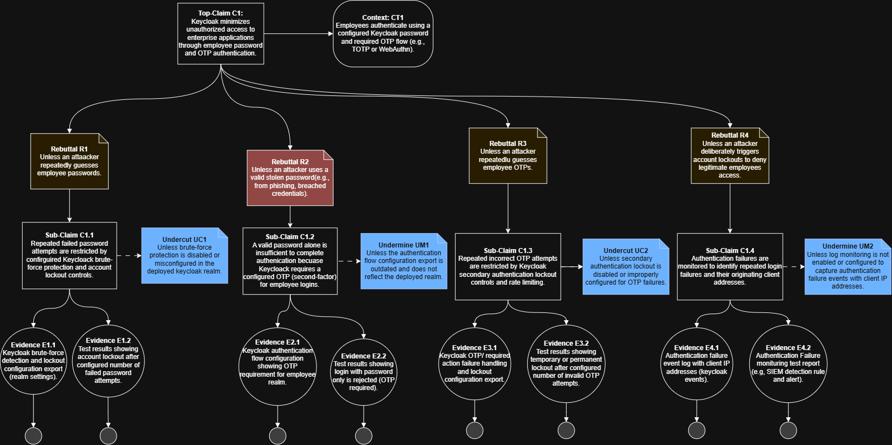
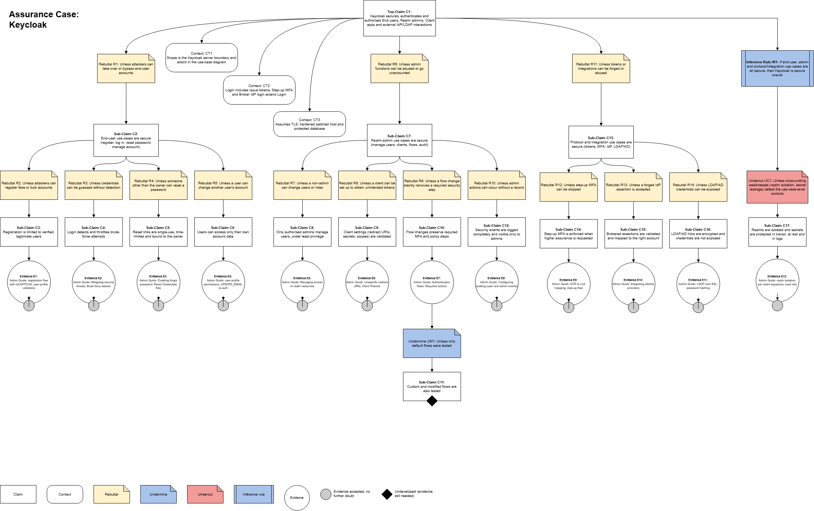
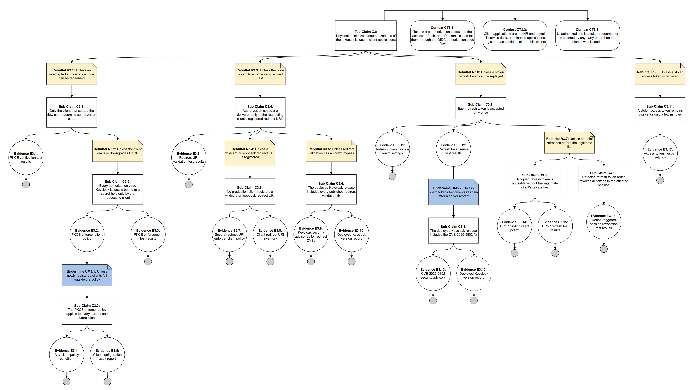
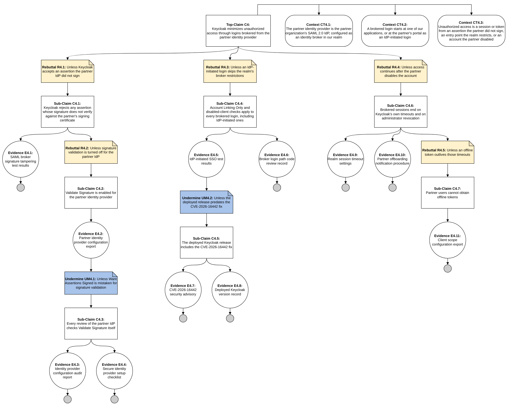
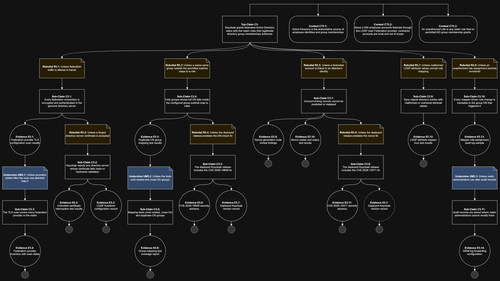

# Assurance Cases for Software Security Engineering — Team 3 (Keycloak)

<!--
TEAM NOTE (doesn't render on GitHub, only visible while editing):
- This file is the deliverable, so only put in what the grader should read.
- Owners, status and checklists live in the issues/project board (milestone "Assignment - Assurance Cases for Software Security Engineering").
- Notation, wording rules and file naming are in diagrams/README.md.
-->

## Part 1 — Assurance Cases

### Top-level claims

1. Keycloak minimizes unauthorized access to enterprise applications through employee password and OTP authentication.
2. Keycloak securely authenticates and authorises End users, Realm admins, Client apps and external IdP/LDAP interactions.
3. Keycloak minimizes unauthorized use of the tokens it issues to client applications.
4. Keycloak minimizes unauthorized access through logins brokered from the partner identity provider.
5. Keycloak grants federated Active Directory users only the realm roles their legitimate directory group memberships authorize. 

---

### Claim 1: Keycloak minimizes unauthorized access to enterprise applications through employee password and OTP authentication

The argument follows the misuse chain from [Interaction 1](Requirements-for-Software-Security-Engineering.md#interaction-1-employee-login). Each rebuttal identifies a way employee authentication could be compromised or disrupted, and each sub-claim addresses that doubt. The four branches cover repeated password guessing (R1), stolen passwords (R2), repeated OTP guessing (R3), and account-lockout denial of service (R4). Configured brute-force protection (C1.1), required OTP (C1.2), secondary authentication failure controls (C1.3), and authentication-failure monitoring (C1.4) provide the corresponding protections. UC1 and UC2 challenge whether the lockout controls are configured correctly, while UM1 and UM2 challenge the reliability of authentication-flow and monitoring evidence. The account-lockout denial-of-service risk remains partially unresolved because monitoring alone does not prevent disruption.



*Source: [`diagrams/assurance-case-claim-1.drawio`](diagrams/assurance-case-claim-1.drawio). Grey circles mark where a branch ends in evidence.*

For clarity, the diagram references TOTP and WebAuthn together, but WebAuthn is a separate authentication mechanism rather than an OTP method. This assurance argument and its evidence assessment focus specifically on the configured password-and-OTP flow.

### Claim 2: Keycloak securely authenticates and authorises End users, Realm admins, Client apps and external IdP/LDAP interactions

The argument follows [Interaction 2](Requirements-for-Software-Security-Engineering.md#interaction-2) from our previous requirements analysis and examines the security of end-user authentication, realm administration, client applications, and external identity integrations. The rebuttals address account takeover, credential abuse, unauthorized administrative actions, insecure client configurations, bypassed authentication controls, and risks involving external identity providers and LDAP connections. Each supporting subclaim identifies a Keycloak security control intended to address these concerns, with corresponding evidence from Keycloak documentation, configuration settings, and available tests. The assurance case also identifies limitations where protections depend on deployment-specific configuration or require additional verification.



*Diagram notation note: The top-level claim in this figure is labeled C1 within the diagram, but it represents Claim 2 in this report. Evidence identifiers E1–E12 are local to this diagram and correspond to the Claim 2 evidence-alignment table.*

### Claim 3: Keycloak minimizes unauthorized use of the tokens it issues to client applications

The argument follows the attack chain from Interaction 3. Each rebuttal is a way someone other than the issuing client could use a token, and each sub-claim removes that doubt. The four branches cover the authorization code (R3.1), where it is delivered (R3.3), the refresh token (R3.6), and the access token (R3.8). Under R3.7, C3.9 and C3.10 are alternatives, and either one removes the doubt. Keycloak supports only C3.9 today, so C3.10 is shown as a gap (E3.16).



*Source: [`diagrams/assurance-case-claim-3.drawio`](diagrams/assurance-case-claim-3.drawio). Grey circles mark where a branch ends in evidence. The dashed E3.10 is the same evidence that supports C3.6, repeated under C3.8 to keep the diagram readable.*

### Claim 4: Keycloak minimizes unauthorized access through logins brokered from the partner identity provider

The argument follows the misuse chain from [Interaction 4](Requirements-for-Software-Security-Engineering.md#interaction-4-identity-brokering---external-identity-provider). Each rebuttal is a way someone could get in through the partner IdP without the partner actually vouching for them, and each sub-claim removes that doubt. The three branches cover forged assertions (R4.1), IdP-initiated logins (R4.3), and access after the partner disables an account (R4.4). Account linking and role mapping (iterations 2 and 3 of Interaction 4) overlap Claim 5 and are left out here.



*Source: [`diagrams/assurance-case-claim-4.drawio`](diagrams/assurance-case-claim-4.drawio). Grey circles mark where a branch ends in evidence.*

### Claim 5: Keycloak grants federated Active Directory users only the realm roles their legitimate directory group memberships authorize

The argument follows the trust boundary from the Part 1 interaction: the federation link through which every employee identity and group membership enters Keycloak from Active Directory. Each rebuttal is a way a federated user could end up holding a realm role that no permitted AD group grants, and each sub-claim removes that doubt. The five branches cover the federation channel (R5.1), the group-to-role mapping (R5.3), the account-linking flow (R5.5), malformed directory data (R5.7), and detection of an unauthorized assignment (R5.8). Context CT5.1 sets the boundary of the claim: a change made by a legitimate AD administrator is authorized from Keycloak's point of view, so insider misuse of AD itself is out of scope. Two branches have no supporting feature in Keycloak today and are shown as gaps: attribute value limits (E5.12) and per-mapping audit events (E5.13).



*Source: [`diagrams/assurance-case-claim-5.drawio`](diagrams/assurance-case-claim-5.drawio). Grey circles mark where a branch ends in evidence.*

---

### AI-assisted improvement

**Prompt used:**

```

> I am developing Claim 1 for our Software Assurance assignment, focusing on employee authentication and credential security in Keycloak. Our top-level claim is: "Keycloak minimizes unauthorized access to enterprise applications through employee password and OTP authentication."
>
> Using the eliminative argumentation approach discussed in class, the faculty's assurance-case example, and our previous requirements and misuse-case analysis, review my assurance argument and help me strengthen its structure.
>
> Specifically:
>
> 1. Evaluate whether my top-level claim describes a meaningful security property rather than simply stating that Keycloak provides certain features.
> 2. Examine the four threats identified in our misuse-case analysis: credential stuffing, stolen passwords, repeated OTP guessing, and account-lockout denial of service.
> 3. Identify appropriate rebuttals using "Unless..." statements and determine whether the supporting subclaims adequately address each rebuttal.
> 4. Identify undercuts or undermines that could challenge the reasoning or reliability of the supporting evidence, particularly where Keycloak security controls depend on configuration.
> 5. Ensure that every argument branch terminates in tangible, measurable evidence expressed as a noun phrase, consistent with the faculty's assurance-case example.
> 6. Recommend improvements to the diagram's structure and notation so I can recreate it accurately in draw.io.
> 7. Distinguish between security capabilities documented by Keycloak and protections that require deployment-specific configuration or testing. Do not assume that controls are enabled or that evidence has been collected.
>
> Explain any weaknesses or unresolved rebuttals rather than treating the assurance argument as fully supported.

```

**Reflection on usefulness:**

AI's ability to structure information grants us the capability of generating the starting structure or validating overlapping information. Though, the one thing all of us agreed on is that it requires human review to check the logic and validate the evidence provided. While AI can structure information swiftly, it does not always assemble it correctly and can lead to logical holes in arguments. This is especially a sensitive matter regarding Software Assurance as having a lack of proper detail could lead to unaddressed or improperly addressed vulnerabilities.

---

## Part 2 — Evidence Alignment Observations

<!-- For each evidence node in your diagram: Available / Can be made available / Requires additional effort. Link the Keycloak doc or code where it exists. -->


### Claim 1

| ID | Evidence | Alignment | Source / where it would come from | Gap |
|---|---|---|---|---|
| E1.1 | Keycloak brute-force detection and lockout configuration export (realm settings) | Can be made available | Realm brute-force detection settings in the [Keycloak Server Administration Guide][c1-brute-force], verified through a realm export. | Brute-force protection must be enabled and configured. No deployment-specific export has been collected; this also relates to UC1. |
| E1.2 | Test results showing account lockout after configured failed password attempts | Requires additional effort | Controlled repeated failed-password attempts against a configured Keycloak test realm. | No deployment-specific lockout test results have been collected. |
| E2.1 | Keycloak authentication-flow configuration showing required OTP for the employee realm | Can be made available | Authentication-flow settings and required OTP execution in the [Keycloak administration documentation][c1-auth-flows]. | No current configuration export has been collected. UM1 also questions whether the export accurately reflects the deployed realm. |
| E2.2 | Test results showing password-only login is rejected (OTP required) | Requires additional effort | Login tests using a valid password without completing the required OTP challenge. | No password-only rejection test results have been collected. |
| E3.1 | Keycloak OTP/required-action failure handling and lockout configuration export | Can be made available | Secondary authentication failure and lockout settings described in the [Keycloak administration documentation][c1-secondary-auth]. | The deployed threshold and protection settings have not been verified; this relates to UC2. |
| E3.2 | Test results showing temporary or permanent lockout after configured invalid OTP attempts | Requires additional effort | Controlled repeated invalid-OTP attempts against a configured test realm. | No OTP failure lockout test results have been collected. |
| E4.1 | Authentication failure event log with client IP addresses (Keycloak events) | Can be made available | Keycloak login-error events and [event logging configuration][c1-auditing]. | Event logging must be configured and retained. No actual records have been collected; this relates to UM2. |
| E4.2 | Authentication failure monitoring test report (e.g., SIEM detection rule and alert) | Requires additional effort | Keycloak authentication events and an integrated monitoring or SIEM system. | No alert-validation test has been collected. Monitoring alone cannot prevent account-lockout denial of service. |

**Claim 1 gaps.** Keycloak documents the authentication protections needed for password and OTP security, but their effectiveness depends on deployment configuration. The largest evidence gaps are the absence of current realm exports, password and OTP lockout tests, and authentication-monitoring validation. UC1 and UC2 identify configuration-dependent protections, while UM1 and UM2 challenge whether the available evidence accurately represents the deployed environment. Account-lockout denial of service remains a residual availability risk because monitoring suspicious authentication failures does not itself stop an attacker from triggering lockouts.

[c1-brute-force]: https://www.keycloak.org/docs/latest/server_admin/index.html#brute-force-attacks
[c1-auth-flows]: https://www.keycloak.org/docs/latest/server_admin/index.html#authentication-flows
[c1-secondary-auth]: https://www.keycloak.org/docs/latest/server_admin/index.html#secondary-authentication-failures-lockout
[c1-auditing]: https://www.keycloak.org/docs/latest/server_admin/index.html#configuring-auditing-to-track-events

### Claim 2

| ID | Evidence | Alignment | Source / where it would come from | Gap |
|---|---|---|---|---|
| E1 | Registration flow with reCAPTCHA; user-profile validators (supports C3) | Available (docs); Can be made available (our settings) | [*Allowing users to self-register* → *Enabling reCAPTCHA*][e1-selfreg] and [*Managing user attributes* → *Validating Attributes*][e1-profile]. Our registration flow and user-profile JSON from a realm export or the Admin REST API. | The docs show the features exist, not that they are enabled for our realm. The claim says "verified", but neither node covers *Verifying a user's email address*. Neither limits registrations by volume (R2). |
| E2 | Mitigating security threats, Brute force attacks (supports C4) | Available (docs); Can be made available (our settings) | [*Mitigating security threats* → *Brute force attacks*][e2-brute] (upstream section: [Admin Guide][kc-admin]). The realm's *Security defenses → Brute force detection* settings from a realm export. | Brute force detection is **disabled by default** in the Red Hat build of Keycloak docs, so the docs alone don't support C4. The mode and thresholds in use have to be recorded. The same page warns the feature makes the server open to lockout-based denial of service. |
| E3 | Enabling forgot password; Reset Credentials flow (supports C5) | Available (docs); Can be made available (lifespan setting) | [*Enabling forgot password*][e3-forgot] and the Reset Credentials flow under [*Authentication flows*][e3-flows]. The *Realm settings → Tokens* tab, *User-Initiated Action Lifespan* ([Red Hat sessions and tokens page][e3-lifespan]; [forum: default 5 minutes][e3-forum]). | The docs give the flow and a time limit. I found no statement that links are single-use. A [forum thread][e3-invalidate] asks how to invalidate an older reset link when a second is requested, which suggests it isn't covered. "Bound to the owner" depends on email delivery. |
| E4 | User-profile permissions; UPDATE_EMAIL re-auth (supports C6) | Available (docs); Can be made available (our settings) | [*Managing Attributes* (Permission)][e4-profile] and [*Update Email Workflow (UpdateEmail)*][e4-updateemail]. User-profile JSON export. | Covers attribute and email changes only. Password change, session management, and the Account Console API aren't cited. UPDATE_EMAIL has to be enabled, and its default re-authentication age is 5 minutes. No test shows a user can't edit another user's account. |
| E5 | Managing access to realm resources (supports C8) | Available (docs); Requires additional effort (assignments) | [*Managing access to realm resources*][e5-access] (master-realm access control, realm roles, fine-grained admin permissions). The list of admin role mappings from the Admin REST API. | The guide shows how to configure least privilege, not that we do. We'd need an export of who holds admin roles, and a review of it. We also need to say whether fine-grained admin permissions V1 or the newer model applies. |
| E6 | Unspecific redirect URIs; Client Policies (supports C9) | Available (docs); Can be made available (client exports) | [*Unspecific redirect URIs*][e6-redirect] and [*Client Policies*][e6-policies] (Securing Client URIs, Client Secret Rotation). Each client's redirect URIs, scopes, and policies from a realm export. | Client Policies are opt-in, so they only count if configured. The claim also covers secrets and scopes, which this node only partly covers. Nothing shows a policy was tested against a bad redirect URI. |
| E7 | Authentication flows; Required actions (supports C10) | Available (docs); Requires additional effort (flow tests) | [*Authentication flows*][e7-flows] and [*Defining actions required at login*][e7-required]. Flow definitions from a realm export. | This is the weakest branch. UM1 says only default flows were tested and C11 is still undeveloped. Nothing in the docs stops an admin from removing a required step. We'd need tests of our custom flows, or a scheduled comparison against an approved baseline. |
| E8 | Configuring auditing, user and admin events (supports C12) | Available (docs); Can be made available (event settings) | [*Configuring auditing to track events*][e8-audit] (*Auditing user events*, *Auditing admin events*). *Realm settings → Events* configuration from a realm export. | Event logging is a setting to turn on, so "complete" isn't guaranteed. Retention, tamper-resistance, and who can read the events aren't covered. |
| E9 | ACR to LoA mapping; step-up flow (supports C14) | Available (docs); Requires additional effort (test) | [*ACR to Level of Authentication (LoA) Mapping*][e9-acr] and [*Creating a browser login flow with step-up mechanism*][e9-stepup]. The realm's mapping and flow from a realm export. | Configuration evidence only. No test shows a client can't skip the step-up by omitting `acr_values`. The docs say SAML step-up needs a separate feature enabled. |
| E10 | Integrating identity providers (supports C15) | Available (docs); Can be made available (IdP config) | [*Integrating identity providers*][e10-idp] and the [SAML identity provider source docs][e10-saml]. Each IdP's configuration from the Admin REST API, with the signature settings in particular. | The chapter explains the options but doesn't show that signature validation is on for each provider. The first-login options (automatic account linking) can allow account takeover if the IdP's email isn't trustworthy. |
| E11 | LDAP over SSL; password hashing (supports C16) | Available (docs); Can be made available (LDAP config) | [*Connecting to LDAP over SSL*][e11-ldaps] and [*Password hashing*][e11-hash], plus the *Configuring a Truststore* guide ([Guides][kc-guides]). LDAP provider settings (URL scheme, truststore) from a realm export. | The guide itself says Keycloak sends passwords to LDAP in plain text and relies on the LDAP server to hash them. Some servers (OpenLDAP) store plain text unless the Password Modify Extended Operation is enabled. Encryption only applies when an `ldaps://` URL is configured. |
| E12 | Realm isolation; per-realm keystores; vault references (supports C17) | Available (docs); Requires additional effort ("in transit" and "in logs") | [*The master realm*][e12-realm], [*Loading keys from a Java Keystore*][e12-keystore], and [*Using a vault to obtain secrets*][e12-vault]. The Server Installation and Configuration guides ([Guides][kc-guides]). | Supports isolation and secret storage only. "In transit" depends on TLS configuration, "in logs" on log settings, and "at rest" on the database. This node also attaches through UC1 and IR1, so a weak E12 weakens the top claim. |

*Gaps across the case.* Keycloak's docs can support most of these nodes (E2, E3, E4, E5, E6, E8, E9), but the case needs more than doc references. Each branch needs a snapshot of **our realm configuration**, which can be pulled from the Admin REST API or a realm export.

Three nodes need more than a configuration snapshot:
- **E7:** the graph already marks this branch as undeveloped (UM1 and C11). It needs tests of the custom authentication flows.
- **E9:** step-up MFA needs a test showing it can't be skipped.
- **E12:** "in transit" and "in logs" have no cited evidence yet.

Two other nodes carry gaps the docs themselves flag:
- **E2:** brute force detection is off by default.
- **E11:** LDAP passwords go to the server in plain text unless `ldaps://` is configured.
  
[kc-admin]: https://www.keycloak.org/docs/latest/server_admin/index.html
[kc-guides]: https://www.keycloak.org/guides
[e1-selfreg]: https://www.keycloak.org/docs/latest/server_admin/index.html
[e1-profile]: https://www.keycloak.org/docs/latest/server_admin/index.html
[e2-brute]: https://docs.redhat.com/en/documentation/red_hat_build_of_keycloak/26.0/html/server_administration_guide/mitigating_security_threats
[e3-forgot]: https://www.keycloak.org/docs/latest/server_admin/index.html
[e3-flows]: https://www.keycloak.org/docs/latest/server_admin/index.html
[e3-lifespan]: https://docs.redhat.com/en/documentation/red_hat_build_of_keycloak/22.0/html/server_administration_guide/managing_user_sessions
[e3-forum]: https://forum.keycloak.org/t/reset-password-token-duration/10253
[e3-invalidate]: https://forum.keycloak.org/t/keycloak-reset-credentials-invalidate-old-tokens/29277
[e4-profile]: https://www.keycloak.org/docs/latest/server_admin/index.html
[e4-updateemail]: https://www.keycloak.org/docs/latest/server_admin/index.html
[e5-access]: https://www.keycloak.org/docs/latest/server_admin/index.html
[e6-redirect]: https://www.keycloak.org/docs/latest/server_admin/index.html
[e6-policies]: https://www.keycloak.org/docs/latest/server_admin/index.html
[e7-flows]: https://www.keycloak.org/docs/latest/server_admin/index.html
[e7-required]: https://www.keycloak.org/docs/latest/server_admin/index.html
[e8-audit]: https://www.keycloak.org/docs/latest/server_admin/index.html
[e9-acr]: https://www.keycloak.org/docs/latest/server_admin/index.html
[e9-stepup]: https://www.keycloak.org/docs/latest/server_admin/index.html
[e10-idp]: https://www.keycloak.org/docs/latest/server_admin/index.html
[e10-saml]: https://github.com/keycloak/keycloak/blob/main/docs/documentation/server_admin/topics/identity-broker/saml.adoc
[e11-ldaps]: https://www.keycloak.org/docs/latest/server_admin/index.html
[e11-hash]: https://www.keycloak.org/docs/latest/server_admin/index.html
[e12-realm]: https://www.keycloak.org/docs/latest/server_admin/index.html
[e12-keystore]: https://www.keycloak.org/docs/latest/server_admin/index.html
[e12-vault]: https://www.keycloak.org/docs/latest/server_admin/index.html

### Claim 3

| ID | Evidence | Alignment | Source / where it would come from | Gap |
|---|---|---|---|---|
| E3.1 | PKCE verification test results | Available | Keycloak's [`OAuthProofKeyForCodeExchangeTest`][c3-pkce-test] covers matching, mismatched, missing, and malformed verifiers for both `S256` and `plain`. | None for Keycloak itself. |
| E3.2 | PKCE enforcer client policy | Can be made available | The [`pkce-enforcer`][c3-pkce-exec] client-policy executor, or the per-client "Require PKCE" switch added in 26.6 ([PR #44365][c3-pr44365]). | Not configured by default; "there are no client policies configured by default" ([client policies docs][c3-cp-docs]). Our realm export would need to show it. |
| E3.3 | PKCE enforcement test results | Available | The `*PkceEnforced` cases in [`OAuthProofKeyForCodeExchangeTest`][c3-pkce-test] (missing challenge, missing method, method mismatch). | Shows the feature works, not that our clients have it turned on. E3.2 closes that gap. |
| E3.4 | Any-client policy condition | Can be made available | The [`any-client`][c3-any-client] client-policy condition. | Our policy would have to use it instead of a narrower condition such as client type, or new clients could slip past (UM3.1). |
| E3.5 | Client configuration audit report | Requires additional effort | Nothing in Keycloak produces one. It would be scripted from the Admin REST API or a realm export and run on a schedule. | Needs to be built and owned by someone. This is the largest process gap. |
| E3.6 | Redirect URI validation test results | Available | [`OAuthRedirectUriTest`][c3-redirect-test] (`testWildcard`, `testLocalhost`, `testLoopback`). | The tests confirm that a registered wildcard is honored as a prefix match, which is exactly the behavior R3.4 doubts. |
| E3.7 | Secure redirect URI enforcer client policy | Can be made available | The [`secure-redirect-uris-enforcer`][c3-sru-exec] executor (Keycloak 24+), tested in [`ClientPoliciesExecutorTest`][c3-cp-exec-test]. | Off by default. |
| E3.8 | Client redirect URI inventory | Can be made available | Each client's `redirectUris` from the Admin REST API or a realm export. | Must be regenerated whenever a client changes. |
| E3.9 | Keycloak security advisories for redirect CVEs | Available | [CVE-2023-6927][c3-cve-6927], [CVE-2024-1132][c3-cve-1132], [CVE-2024-8883][c3-cve-8883]. | None. |
| E3.10 | Deployed Keycloak version record | Can be made available | The admin console's *Server info* page. | Our deployment is hypothetical; the record is only useful if a patch process keeps it current. |
| E3.11 | Refresh token rotation realm settings | Can be made available | *Revoke Refresh Token* on, with *Refresh Token Max Reuse* set to 0. | Off by default and realm-wide only; a per-client setting is still a proposal ([PR #51798][c3-pr51798]). |
| E3.12 | Refresh token reuse test results | Available | [`RefreshTokenRevokeTest`][c3-rt-test] (`refreshTokenReuseTokenWithRefreshTokensRevoked`, `refreshTokenSameSecondReplayRejected`, and the concurrent-request cases). | Runs against a single test server and does not cover a restart with persistent sessions (UM3.2). |
| E3.13 | CVE-2026-9802 security advisory | Available | [CVE-2026-9802][c3-cve-9802] ([Keycloak issue #49426][c3-issue49426]). | None. |
| E3.14 | DPoP binding client policy | Can be made available | The *Require DPoP bound tokens* client setting or the [`dpop-bind-enforcer`][c3-dpop-exec] executor ([Keycloak 26.4+][c3-dpop-blog]). | Off by default. Each public client must also send DPoP proofs, which may require changes to our applications. |
| E3.15 | DPoP refresh test results | Available | [`DPoPTest`][c3-dpop-test] (`testDPoPByPublicClientTokenRefreshWithoutDPoPProof`, `testBindOnlyRefreshTokenDPoPEnforcerExecutor`, `testTokenRefreshWithReplayedDPoPProofByPublicClient`). | None for Keycloak itself. |
| E3.16 | Reuse-triggered session revocation test results | Requires additional effort | No implementation was located in [`TokenManager`][c3-tokenmanager] or [`RefreshTokenGrantType`][c3-rtgrant] (SR-3.6). Producing this evidence would require a Keycloak change or an upstream feature request. | The largest technical gap: C3.10 has no support today. |
| E3.17 | Access token lifespan settings | Available | The realm *Access Token Lifespan* and each client's override. | A client override can lengthen the lifespan, so E3.5 would also need to check overrides. |

*Claim 3 gaps.* Keycloak's own tests already cover each existing mechanism this argument relies on, so evidence about Keycloak's *behavior* is largely available. The gaps are in evidence about *our configuration*: five items (E3.2, E3.4, E3.7, E3.11, E3.14) depend on settings that are off by default and would have to be exported from our realm, and nothing in Keycloak produces the audit report (E3.5) that would show those settings stay in place. The one gap Keycloak itself cannot close today is E3.16: without revoking the session on detected reuse, C3.10 is unsupported, and R3.7 rests entirely on C3.9 (DPoP for public clients).

[c3-pkce-test]: https://github.com/keycloak/keycloak/blob/main/testsuite/integration-arquillian/tests/base/src/test/java/org/keycloak/testsuite/oauth/OAuthProofKeyForCodeExchangeTest.java
[c3-pkce-exec]: https://github.com/keycloak/keycloak/blob/main/services/src/main/java/org/keycloak/services/clientpolicy/executor/PKCEEnforcerExecutor.java
[c3-pr44365]: https://github.com/keycloak/keycloak/pull/44365
[c3-cp-docs]: https://github.com/keycloak/keycloak/blob/main/docs/documentation/server_admin/topics/clients/client-policies.adoc
[c3-any-client]: https://github.com/keycloak/keycloak/blob/main/services/src/main/java/org/keycloak/services/clientpolicy/condition/AnyClientConditionFactory.java
[c3-redirect-test]: https://github.com/keycloak/keycloak/blob/main/testsuite/integration-arquillian/tests/base/src/test/java/org/keycloak/testsuite/oauth/OAuthRedirectUriTest.java
[c3-sru-exec]: https://github.com/keycloak/keycloak/blob/main/services/src/main/java/org/keycloak/services/clientpolicy/executor/SecureRedirectUrisEnforcerExecutor.java
[c3-cp-exec-test]: https://github.com/keycloak/keycloak/blob/main/testsuite/integration-arquillian/tests/base/src/test/java/org/keycloak/testsuite/client/policies/ClientPoliciesExecutorTest.java
[c3-cve-6927]: https://www.cve.org/CVERecord?id=CVE-2023-6927
[c3-cve-1132]: https://www.cve.org/CVERecord?id=CVE-2024-1132
[c3-cve-8883]: https://www.cve.org/CVERecord?id=CVE-2024-8883
[c3-pr51798]: https://github.com/keycloak/keycloak/pull/51798
[c3-rt-test]: https://github.com/keycloak/keycloak/blob/main/tests/base/src/test/java/org/keycloak/tests/oauth/RefreshTokenRevokeTest.java
[c3-cve-9802]: https://www.cve.org/CVERecord?id=CVE-2026-9802
[c3-issue49426]: https://github.com/keycloak/keycloak/issues/49426
[c3-dpop-exec]: https://github.com/keycloak/keycloak/blob/main/services/src/main/java/org/keycloak/services/clientpolicy/executor/DPoPBindEnforcerExecutorFactory.java
[c3-dpop-blog]: https://www.keycloak.org/2025/10/dpop-support-26-4
[c3-dpop-test]: https://github.com/keycloak/keycloak/blob/main/tests/base/src/test/java/org/keycloak/tests/oauth/DPoPTest.java
[c3-tokenmanager]: https://github.com/keycloak/keycloak/blob/main/services/src/main/java/org/keycloak/protocol/oidc/TokenManager.java
[c3-rtgrant]: https://github.com/keycloak/keycloak/blob/main/services/src/main/java/org/keycloak/protocol/oidc/grants/RefreshTokenGrantType.java

### Claim 4

| ID | Evidence | Alignment | Source / where it would come from | Gap |
|---|---|---|---|---|
| E4.1 | SAML broker signature tampering test results | Available | The `testSignatureTampering_*` cases in [`KcSamlSignedBrokerTest`][c4-signed-test] cover all eight combinations of signed document, signed assertion, and encrypted assertion. | They run with Validate Signature on, so they show the feature works, not that our provider has it on. E4.2 closes that gap. |
| E4.2 | Partner identity provider configuration export | Can be made available | The partner provider's `validateSignature`, `wantAssertionsSigned`, and signing certificate from the Admin REST API or a realm export. | A snapshot of one moment, and easy to misread (UM4.1). |
| E4.3 | Identity provider configuration audit report | Requires additional effort | Nothing in Keycloak produces one. It would be scripted from the Admin REST API and run on a schedule. | Needs to be built and owned by someone, the same gap as E3.5. |
| E4.4 | Secure identity provider setup checklist | Requires additional effort | Our [SSE documentation review][c4-sse-review] proposed one: Validate Signature on, Identity Provider Entity ID set, mappers reviewed. | Keycloak's [SAML identity provider docs][c4-idp-docs] have no such checklist and never say that Want Assertions Signed only checks that a signature is present ([`SAMLEndpoint`][c4-saml-endpoint]). |
| E4.5 | IdP-initiated SSO test results | Available | [`KcSamlIdPInitiatedSsoTest`][c4-idp-test] (`testLinkOnlyBrokerIdpInitiated`, `testDisabledClient`, `testDisabledBroker`). | The tests cover current code, not the release we run (UM4.2). |
| E4.6 | Broker login path code review record | Available | Our SSE review of [`IdentityBrokerService`][c4-broker-svc] for SR-4.4, which found the Account Linking Only and disabled-client checks on every brokered login. | Tied to one commit, so it has to be repeated after upgrades. |
| E4.7 | CVE-2026-16442 security advisory | Available | [CVE-2026-16442][c4-cve-16442]: the IdP-initiated SSO endpoint did not check whether a provider was restricted to account linking. | None. |
| E4.8 | Deployed Keycloak version record | Can be made available | The admin console's *Server info* page. | Same as E3.10: only useful if a patch process keeps it current. |
| E4.9 | Realm session timeout settings | Available | The realm's *SSO Session Idle* (30 minutes by default) and *SSO Session Max* (10 hours by default) ([defaults][c4-timeouts]). | They do not apply to offline tokens (R4.5). |
| E4.10 | Partner offboarding notification procedure | Requires additional effort | An agreement that the partner tells us when a contractor leaves, followed by an admin sign-out in Keycloak. | Keycloak is never told when the partner disables an account, and nothing inside Keycloak can close this gap. |
| E4.11 | Client scope configuration export | Can be made available | Each partner-facing client's optional client scopes, from the Admin REST API or a realm export. | Opt-out, not opt-in: `offline_access` is added to clients as an optional client scope by default, and an offline token stays valid after logout ([offline access docs][c4-offline-docs]). |

*Claim 4 gaps.* Keycloak's own tests cover both mechanisms this argument relies on (E4.1, E4.5), so evidence about Keycloak's *behavior* is available. CVE-2026-16442 shows the IdP-initiated check behind C4.4 was missing in earlier releases, which is why UM4.2 asks for a version record. As in Claim 3, the gaps are in evidence about *our configuration*: Validate Signature has to be on and stay on (E4.2 to E4.4), and offline access has to be removed for partner-facing clients (E4.11). The one gap Keycloak cannot close at all is E4.10: it is never told when the partner disables an account, so cutting off a contractor before the session times out depends on a procedure with the partner.

[c4-signed-test]: https://github.com/keycloak/keycloak/blob/main/testsuite/integration-arquillian/tests/base/src/test/java/org/keycloak/testsuite/broker/KcSamlSignedBrokerTest.java
[c4-idp-test]: https://github.com/keycloak/keycloak/blob/main/testsuite/integration-arquillian/tests/base/src/test/java/org/keycloak/testsuite/broker/KcSamlIdPInitiatedSsoTest.java
[c4-saml-endpoint]: https://github.com/keycloak/keycloak/blob/6688a3d63f59e0c4a9131bfdd556c4312799f04e/services/src/main/java/org/keycloak/broker/saml/SAMLEndpoint.java#L604-L614
[c4-broker-svc]: https://github.com/keycloak/keycloak/blob/6688a3d63f59e0c4a9131bfdd556c4312799f04e/services/src/main/java/org/keycloak/services/resources/IdentityBrokerService.java#L723-L770
[c4-sse-review]: Requirements-for-Software-Security-Engineering.md#part-2--oss-documentation-review
[c4-idp-docs]: https://github.com/keycloak/keycloak/blob/main/docs/documentation/server_admin/topics/identity-broker/saml.adoc
[c4-cve-16442]: https://www.cve.org/CVERecord?id=CVE-2026-16442
[c4-timeouts]: https://github.com/keycloak/keycloak/blob/6688a3d63f59e0c4a9131bfdd556c4312799f04e/server-spi-private/src/main/java/org/keycloak/models/Constants.java#L64-L72
[c4-offline-docs]: https://github.com/keycloak/keycloak/blob/main/docs/documentation/server_admin/topics/sessions/offline.adoc


### Claim 5

| ID | Evidence | Alignment | Source / where it would come from | Gap |
|---|---|---|---|---|
| E5.1 | Federation provider TLS configuration scan results | Can be made available | Each provider's Connection URL (ldap:// vs ldaps://) and startTls setting, readable from the Admin REST API or a realm export | Keycloak accepts plaintext ldap:// with StartTLS off; nothing in the realm prevents it. The scan has to be written and run by us. |
| E5.2 | Untrusted-certificate interception test results | Requires additional effort | UserFederationLdapConnectionTest.testLdapConnectionsSsl checks that ldaps:// connections succeed and fail as expected, but no upstream test presents a forged certificate. | A lab MITM test against our own AD connection would have to be built. |
| E5.3 | LDAP truststore configuration record | Can be made available | Server truststore options (Configuring a truststore); the LDAP doc says Use Truststore SPI should stay at Always. | Trust depends entirely on what the operator puts in the truststore; no warning when a provider connects to an untrusted server. |
| E5.4 | Federation provider inventory with scan dates | Requires additional effort | Nothing in Keycloak produces one. It would be generated from the Admin REST API on a schedule, alongside E5.1. | Needs an owner. Without it, UM5.1 (a provider added after the scan) stays open. |
| E5.5 | Duplicate-CN group mapping test results | Available | LDAPGroupMapperTest.test05_DoNotResolveGroupsIfMemberOfNotChildOfGroupBaseDN puts a user in cn=mygroup under a different base DN and asserts no group is imported; test10_multipleGroupMappersInDifferentPaths covers two mappers in separate paths. | The DN-scope test only exercises the memberOf retrieval strategy, not the default member attribute strategy. |
| E5.6 | CVE-2026-19608 security advisory | Available (subject to source verification) | CVE-2026-19608 security advisory concerning group-policy matching and same-name group claims. | The advisory must be checked against the deployed Keycloak version. The diagram's C5.5 requires evidence that the deployed release contains the relevant fix. |
| E5.7 | Deployed Keycloak version record | Can be made available | Server info in the Admin Console or /admin/serverinfo. | Has to be recorded for our deployment and compared against the relevant security advisories, including CVE-2026-19608 and CVE-2026-15571. |
| E5.8 | Group-mapping test coverage report | Requires additional effort | Generated by running the federation/ldap module and testsuite/.../federation/ldap tests with a coverage tool such as JaCoCo. | The project doesn't publish per-module coverage. |
| E5.9 | Nonce generation code review findings | Requires additional effort | IdentityBrokerService.clientInitiatedAccountLinking checks a client-supplied SHA-256 hash of nonce + session ID + client ID + provider alias. | The review has to be done by us. The legacy endpoint is now off by default (KcOidcBrokerIdpLinkActionTest.testLegacyClientInitiatedAccountLinking_disabledByDefault); the replacement is the idp_link application-initiated action. |
| E5.10 | Nonce replay and expiry test results | Requires additional effort | KcOidcBrokerIdpLinkActionTest covers successful, cancelled, rejected and wrong-user linking. | No upstream test replays a used linking URL or checks expiry. |
| E5.11 | CVE-2026-15571 security advisory | Available | NVD and Red Hat: predictable hash in the legacy account-linking endpoint; fixed in 26.7.2 | None for Keycloak itself. |
| E5.12 | LDAP attribute mapper fuzz test results | Requires additional effort | LDAPSpecialCharsTest and LDAPDnTest cover special characters in names and DNs, but no fuzzing exists. | UserAttributeLDAPStorageMapper has no limit on the number of values imported (SR-5). The User Profile multivalued validator caps values for edits, but it is untested whether it applies on LDAP import. Likely a real gap. |
| E5.13 | Mapper role-assignment audit log sample | Requires additional effort | Admin events record actions taken through the Admin REST API (Auditing admin events). | Role and group changes made by an LDAP mapper during sync or login are not admin REST calls, so nothing records which group DN produced which role (SR-6). This is the largest gap. |
| E5.14 | SIEM log forwarding configuration | Can be made available | The jboss-logging event listener writes events to the server log, which can be shipped to a SIEM (Configuring auditing). | Only covers events Keycloak emits, so it does not close E5.13. |

*Claim 5 gaps.* Keycloak's own tests cover the core mapping behavior this argument relies on (E5.5), and CVE-2026-15571 shows the account-linking hash behind C5.7 was predictable before 26.7.2, which is why R5.6 asks for a deployed Keycloak version record (E5.7). As in Claims 3 and 4, most gaps are in evidence about *our configuration*: every federation provider has to use `ldaps://` or StartTLS and stay that way (E5.1 to E5.4), and every group mapper and group policy has to use full group paths. CVE-2026-19608 (E5.6) raises a group-mapping concern that requires verification against the deployed Keycloak version (E5.7). The original assessment identifies no published fix for CVE-2026-19608, so the diagram's C5.5 assertion that the deployed release contains a fix remains unverified. Two additional evidence gaps remain. It places no limit on the attribute values it imports during sync, so malformed directory data is untested (E5.12). And it never records which AD group produced a mapper-driven role assignment, so an unauthorized role granted through sync leaves no trace that ties it back to its source; forwarding events to a SIEM (E5.14) does not help, because the event is never emitted (E5.13).

### Summary of gaps

Our evidence-alignment assessment across the five assurance cases shows that Keycloak provides documentation, source code, and existing tests that support several of the security controls identified in our diagrams. However, not all the evidence is currently available, and some evidence would require additional configuration, testing, or monitoring to collect.

**Claim 1 — Employee Authentication and Credential Security:** Keycloak documents brute-force protection, OTP authentication, and authentication-event logging. Configuration exports could be collected to verify these controls in a deployed realm. However, password and OTP lockout test results, authentication-flow verification, and monitoring validation require additional effort. Account-lockout denial of service remains a gap because monitoring suspicious login attempts does not prevent an attacker from triggering account lockouts.

**Claim 2 — Realm Administration and Credential Security:** Keycloak documentation supports several administrative security controls, including authentication flows, access permissions, auditing, and credential management. However, deployment-specific configuration exports and additional tests are needed to confirm that these protections are enforced. The remaining gaps include custom authentication-flow testing, step-up authentication verification, and evidence supporting protections for data in transit and logs. The documentation also identifies limitations involving brute-force protection being disabled by default and LDAP connections that may transmit passwords in plain text if not securely configured.

**Claim 3 — Token Security:** Existing Keycloak source code and tests provide evidence for several token security mechanisms, including PKCE verification, redirect URI validation, refresh token handling, and DPoP. However, some protections depend on client policies or realm settings that must be verified through configuration exports. Additional effort is required to collect client configuration audit reports and validate deployment-specific settings. A significant gap remains in detecting token reuse and revoking the affected session, which the reviewed Keycloak implementation does not currently support as claimed in the assurance case.

**Claim 4 — Identity Brokering:** Existing Keycloak tests and security advisories support several identity-brokering protections, including SAML signature validation and broker login behavior. However, identity provider configuration exports, recurring configuration audits, and additional validation are needed to establish that these protections are correctly applied. A remaining gap is partner account offboarding because Keycloak does not automatically receive notification when a partner disables an account. Additional procedures and controls are therefore required to address this limitation.

**Claim 5 — Active Directory Federation:** Keycloak documentation, source code, tests, and security advisories provide evidence for LDAP federation and group-mapping behavior. However, configuration exports, certificate-interception tests, directory group-mapping tests, and audit records require additional effort to collect. Important gaps remain in verifying trusted LDAP connections, preventing unauthorized role assignments through directory mapping, and recording which Active Directory group caused a role assignment. Some of these limitations cannot be resolved through configuration evidence alone.

**Overall Assessment:** The main gaps across our five assurance cases involve deployment-specific configuration evidence, additional security testing, monitoring and auditing, and security behaviors that Keycloak does not currently support. Existing documentation and tests provide evidence of Keycloak's capabilities, but they do not automatically demonstrate that those protections are enabled or effective in our proposed enterprise environment. Therefore, some evidence can be made available through configuration exports and testing, while other gaps require additional implementation, external controls, or changes to the assurance argument.

This assessment helped us distinguish between security controls supported by existing evidence, controls that require further verification, and limitations that remain unresolved. These gaps must be acknowledged when evaluating how much confidence the available evidence provides in our security claims.


---

## Project Repository and Project Management

[Assurance Cases Milestones](https://github.com/JBoogieman/SoftwareAssuranceTeam3/milestone/3)

[Project Board](https://github.com/users/JBoogieman/projects/1/views/2)

---
## Team Reflection

### What did we learn from this assignment?

This assignment helped our team understand that software assurance is not simply about identifying the security features a system provides, but about developing arguments and gathering evidence to support security claims. We learned how to use claims, rebuttals, subclaims, and evidence to examine whether Keycloak's security controls adequately address potential threats.

One important lesson was that documented security capabilities do not necessarily guarantee protection in a deployed environment. Controls such as brute-force protection, OTP authentication, and LDAP security depend on proper configuration and supporting evidence. Developing rebuttals, undercuts, and undermines helped us challenge our own assumptions and identify gaps in our arguments. We also learned that some security claims needed to be revised when the available evidence did not fully support them.

Beyond the technical work, we learned the importance of teamwork and adapting to unexpected changes. Losing a team member required us to redistribute responsibilities, communicate clearly, and continue working toward the assignment deadline while maintaining the quality of our work.

### What did we find most useful?

The most useful part of this assignment was connecting our previous misuse-case analysis to the assurance cases. This helped us move from identifying potential threats to evaluating whether Keycloak's security controls could address them and what evidence would be needed to support those conclusions.

We also found the evidence-alignment assessment particularly valuable. Reviewing Keycloak's documentation, source code, and available tests helped us distinguish between what the system supports, what depends on configuration, and what still requires additional verification. Building the diagrams also helped us visualize where our arguments were strong and where gaps remained.

AI assistance was useful for brainstorming potential rebuttals and identifying attack scenarios we might have overlooked. However, we learned that its suggestions still needed to be checked against reliable technical sources. Overall, the assignment strengthened our understanding of how to critically evaluate security claims, recognize limitations, and build confidence through evidence rather than assumptions.

<!-- Compiled from individual reflections in the issue: What did you learn? What did you find most useful? -->
