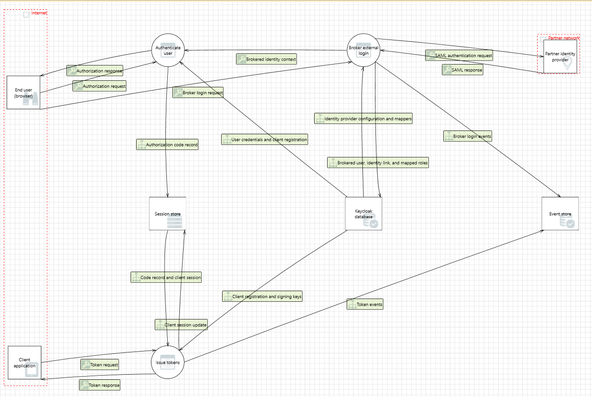

# Designing for Software Security Engineering — Team 3 (Keycloak)

<!--
TEAM NOTE (doesn't render on GitHub, only visible while editing):
- This file is the deliverable, so only put in what the grader should read. Owners, status and checklists live in the issues/project board.
- Due Fri Nov 20, 11:59 PM. The Canvas submission is a link to this file.
- Scope is the same as before: Keycloak's authorization and credential subsystem, built from our five interactions (Requirements) and five claims (Assurance Cases).
- One Level 1 DFD should cover all five interactions. Add a Level 2 only if one area gets too crowded to read. TMT threat analysis is run on the final diagram only, not on drafts.
- TMT only runs on Windows, and .tm7 files can't be merged, so one person owns the .tm7. Everyone else sends diagram changes and threat decisions through their issue.
- Use TMT's default template (SDL TM Knowledge Base). The Azure template adds cloud threats that don't apply to us.

DFD wording rules (Model Quality is 30 pts: "proper wording of the model elements, clean, coherent and valid DFD"):
- Process: verb phrase ("Authenticate user", "Issue tokens").
- Data flow: noun phrase for the data that moves ("Authorization code", "OTP code"), never an action.
- Every process has at least one flow in and one flow out.
- No flow goes straight between two external entities, two data stores, or an external entity and a data store. It has to pass through a process.
- Draw a trust boundary wherever the owner or privilege level changes. In TMT, cross-boundary flows have to physically cross the boundary line, or TMT won't generate the boundary threats.

Starting element list (draft, change it as needed):
- External entities: End user (browser), Realm administrator, Client application, Partner identity provider, Active Directory
- Processes: Authenticate user, Manage realm configuration, Issue tokens, Broker external login, Synchronize federated users
- Data stores: Keycloak database (realms, users, credentials, clients, role mappings), Session store, Event store
- Trust boundaries: Internet, Partner network, Corporate directory, Keycloak data tier

Files:
- threat-model/keycloak-threat-model.tm7 (TMT source)
- threat-model/dfd-level-1.png (diagram export, embedded below)
- threat-model/keycloak-threat-model-report.htm (TMT full HTML report)
-->

## Part 1 — Threat Modeling

### Scenarios covered

Each scenario from our [Requirements](Requirements-for-Software-Security-Engineering.md) and [Assurance Cases](Assurance-Cases-for-Software-Security-Engineering.md) deliverables is covered by the DFD below.

| # | Scenario | External entity | Trust boundary crossed | Assurance claim |
|---|---|---|---|---|
| 1 | End-user authentication (browser login + OTP) | End user (browser) | Internet → Keycloak | Claim 1 |
| 2 | Realm admin manages credentials and password policy | Realm administrator | Internet → Keycloak admin endpoints | Claim 2 |
| 3 | Client application token acquisition (OIDC authorization code flow) | Client application | Internet → Keycloak | Claim 3 |
| 4 | Identity brokering from an external identity provider | Partner identity provider | Partner network → Keycloak | Claim 4 |
| 5 | Directory federation (LDAP / Active Directory) | Active Directory | Keycloak → corporate directory | Claim 5 |

### Level 1 DFD

*Source: [`threat-model/keycloak-threat-model.tm7`](threat-model/keycloak-threat-model.tm7).*

TBD: two or three sentences walking through the diagram: the main processes and data stores, where the trust boundaries are, and which part of the diagram supports each scenario.

### TMT threat report

Full HTML report: [Keycloak threat model report](https://htmlpreview.github.io/?https://github.com/JBoogieman/SoftwareAssuranceTeam3/blob/main/threat-model/keycloak-threat-model-report.htm)

TMT generated TBD threats for the final diagram. Each one was reviewed in TMT and given a state: TBD mitigated, TBD not applicable, TBD needs investigation.

### Mitigations

<!--
Only the threats we found relevant and logical. Start with threats on flows that cross a trust boundary. Use TMT's threat IDs so each row can be checked against the report.
-->

#### Interaction 1 — End-user authentication

| TMT ID | Threat (STRIDE) | Flow | Mitigation strategy |
|---|---|---|---|
| TBD | TBD | TBD | TBD |

#### Interaction 2 — Realm admin manages credentials and password policy

| TMT ID | Threat (STRIDE) | Flow | Mitigation strategy |
|---|---|---|---|
| TBD | TBD | TBD | TBD |

#### Interaction 3 — Client application token acquisition

| TMT ID | Threat (STRIDE) | Flow | Mitigation strategy |
|---|---|---|---|
| TBD | TBD | TBD | TBD |

#### Interaction 4 — Identity brokering

| TMT ID | Threat (STRIDE) | Flow | Mitigation strategy |
|---|---|---|---|
| TBD | TBD | TBD | TBD |

#### Interaction 5 — Directory federation

| TMT ID | Threat (STRIDE) | Flow | Mitigation strategy |
|---|---|---|---|
| TBD | TBD | TBD | TBD |

---

## Part 2 — Observations

<!--
For each high-priority threat from Part 1, check whether Keycloak actually implements the mitigation we expected. Cite the code, test, documentation, or default setting. Evidence from the Assurance Cases Part 2 tables can be reused where it applies.
-->

### Interaction 1 — End-user authentication

| TMT ID | Expected mitigation | In Keycloak? | Where we looked | Gap |
|---|---|---|---|---|
| TBD | TBD | Yes / Partial / Config-dependent / No | TBD | TBD |

### Interaction 2 — Realm admin manages credentials and password policy

| TMT ID | Expected mitigation | In Keycloak? | Where we looked | Gap |
|---|---|---|---|---|
| TBD | TBD | Yes / Partial / Config-dependent / No | TBD | TBD |

### Interaction 3 — Client application token acquisition

| TMT ID | Expected mitigation | In Keycloak? | Where we looked | Gap |
|---|---|---|---|---|
| TBD | TBD | Yes / Partial / Config-dependent / No | TBD | TBD |

### Interaction 4 — Identity brokering

| TMT ID | Expected mitigation | In Keycloak? | Where we looked | Gap |
|---|---|---|---|---|
| TBD | TBD | Yes / Partial / Config-dependent / No | TBD | TBD |

### Interaction 5 — Directory federation

| TMT ID | Expected mitigation | In Keycloak? | Where we looked | Gap |
|---|---|---|---|---|
| TBD | TBD | Yes / Partial / Config-dependent / No | TBD | TBD |

### Summary of gaps

TBD: the most important gaps across all five interactions, highest priority first.

---

## Project Board

Task assignments and collaboration for this deliverable: [Project Board](https://github.com/users/JBoogieman/projects/1), milestone TBD.

## Team Reflection

TBD: compiled from each member's answers to "What did you learn from this assignment?" and "What did you find most useful?"

