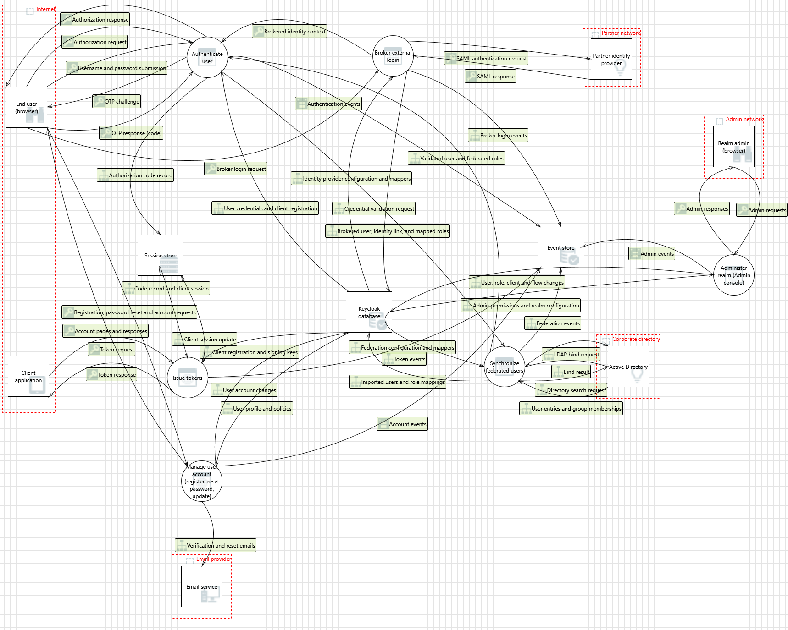

# Designing for Software Security Engineering — Team 3 (Keycloak)

<!--
TEAM NOTE (doesn't render on GitHub, only visible while editing):
- This file is the deliverable, so only put in what the grader should read. Owners, status and checklists live in the issues/project board.
- Due Fri Nov 20, 11:59 PM. The Canvas submission is a link to this file.
- Scope is the same as before: Keycloak's authorization and credential subsystem, built from our five interactions (Requirements) and five claims (Assurance Cases).
- One Level 1 DFD should cover all five interactions. Add a Level 2 only if one area gets too crowded to read. TMT threat analysis is run on the final diagram only, not on drafts.
- TMT only runs on Windows, and .tm7 files can't be merged, so one person owns the .tm7. Everyone else sends diagram changes and threat decisions through their issue.
- Use TMT's default template (SDL TM Knowledge Base). The Azure template adds cloud threats that don't apply to us.
- Every TMT threat gets a state and a Justification in TMT itself: the mitigation, or why it doesn't apply. That text is what the HTML report shows, and it's how prior-year teams documented mitigations. Several of them submitted reports with threats still "Not Started", so none of ours should be.
- The markdown tables below only carry the threats we found relevant, starting with cross-boundary flows. Same wording in both places.
- Each interaction lists its DFD flows as F<interaction>.<n>. Use the same noun phrase as the flow's label in TMT so the report's "Interaction:" headings line up with our tables.
- Prior-year reports had about 5-8 threats per flow and 30-120 threats total. Five interactions on one diagram will run higher, so draw only the flows each scenario needs.

DFD wording rules (Model Quality is 30 pts: "proper wording of the model elements, clean, coherent and valid DFD"):
- Process: verb phrase ("Authenticate user", "Issue tokens").
- Data flow: noun phrase for the data that moves ("Authorization code", "OTP code"), never an action.
- Every process has at least one flow in and one flow out.
- No flow goes straight between two external entities, two data stores, or an external entity and a data store. It has to pass through a process.
- Draw a trust boundary wherever the owner or privilege level changes. In TMT, cross-boundary flows have to physically cross the boundary line, or TMT won't generate the boundary threats.

Starting element list (draft, change it as needed):
- External entities: End user (browser), Realm administrator, Client application, Partner identity provider, Active Directory
- Processes: Authenticate user, Manage realm configuration, Issue tokens, Broker external login, Synchronize federated users
- Data stores: Keycloak database (realms, users, credentials, clients, role mappings), Session store, Event store
- Trust boundaries: Internet, Partner network, Corporate directory
- No boundary around the data stores: they sit inside Keycloak's trust zone. A "Keycloak data tier" box made every database and cache flow cross a boundary, which added 58 generic crash, sniffing and spoofing threats for Interactions 3 and 4 alone (134 down to 76 without it).

Files:
- threat-model/keycloak-threat-model.tm7 (TMT source)
- threat-model/dfd-level-1.png (diagram export, embedded below)
- threat-model/keycloak-threat-model-report.htm (TMT full HTML report)
-->

## Part 1 — Threat Modeling

### Scenarios covered

Each scenario from our [Requirements](Requirements-for-Software-Security-Engineering.md) and [Assurance Cases](Assurance-Cases-for-Software-Security-Engineering.md) deliverables is covered by the DFD below.

| # | Scenario | External entity | Trust boundary crossed | Assurance claim |
|---|---|---|---|---|
| 1 | End-user authentication (browser login + OTP) | End user (browser) | Internet → Keycloak | Claim 1 |
| 2 | Realm admin manages credentials and password policy | Realm admin (browser) | Admin network → Keycloak | Claim 2 |
| 3 | Client application token acquisition (OIDC authorization code flow) | Client application | Internet → Keycloak | Claim 3 |
| 4 | Identity brokering from an external identity provider | Partner identity provider | Partner network → Keycloak | Claim 4 |
| 5 | Directory federation (LDAP / Active Directory) | Active Directory | Keycloak → corporate directory | Claim 5 |

### Level 1 DFD

*Source: [`threat-model/keycloak-threat-model.tm7`](threat-model/keycloak-threat-model.tm7).*

The diagram has one Keycloak trust zone with six processes (Authenticate user, Issue tokens, Broker external login, Synchronize federated users, Manage user account, and Administer realm) and three data stores (the Keycloak database, the Session store and the Event store). Five trust boundaries separate it from the external entities: the Internet (End user browser and Client application), the Admin network (Realm admin), the Partner network (Partner identity provider), the Corporate directory (Active Directory) and the Email provider (Email service). Scenario 1 runs through Authenticate user, Scenario 2 through Administer realm and Manage user account, Scenario 3 through Issue tokens, Scenario 4 through Broker external login, and Scenario 5 through Synchronize federated users. All five share the data stores, which is why some data-store threats appear under more than one interaction.

### TMT threat report

Full HTML report: [view in browser](https://htmlpreview.github.io/?https://github.com/JBoogieman/SoftwareAssuranceTeam3/blob/main/threat-model/keycloak-threat-model-report.htm) or [download](threat-model/keycloak-threat-model-report.htm) (*Download raw file*, then open it locally).

TMT generated 193 threats for the final diagram. Each one was reviewed in TMT and given a state: 148 mitigated, 12 not applicable, 33 needs investigation.

### Mitigations

<!--
Only the threats we found relevant and logical. Start with threats on flows that cross a trust boundary. Use TMT's threat IDs so each row can be checked against the report.
-->

#### Interaction 1 — End-user authentication

The end user's browser is outside Keycloak's trust boundary. The browser sends authorization requests, username/password credentials, and OTP responses to the `Authenticate user` process, while Keycloak returns authorization responses and OTP challenges. The process also reads credential records, maintains authentication sessions, and writes authentication events. The highest-priority threats concern impersonation, bypassing required authentication steps, exposure of credentials or OTPs, availability, and incomplete audit records.

| TMT ID | Threat (STRIDE) | Flow | Mitigation strategy |
|---|---|---|---|
| 172 | **Spoofing.** An attacker initiates an authorization request while pretending to be a legitimate browser user. | Authorization request | Authenticate the user before granting access. Validate registered redirect URIs and require PKCE (`S256`) through a client policy. The browser's identity alone is not trusted. |
| 1 | **Tampering.** Untrusted authorization parameters are reflected into login pages and cause cross-site scripting (XSS). | Authorization request | Use Keycloak's FreeMarker HTML auto-escaping and keep Keycloak patched. Review custom login themes before deployment. |
| 88, 87 | **Elevation of privilege.** Forged authorization requests or manipulated authentication steps bypass the intended login flow. | Authorization request | Bind requests to the server-side authentication session using `session_code`, `execution`, and `tab_id`; reject invalid or replayed steps. Clients must validate OIDC `state`. |
| 89 | **Spoofing.** A manipulated redirect URI sends an authorization response to an attacker-controlled destination. | Authorization response | Register exact redirect URIs and enable the `secure-redirect-uris-enforcer` client policy. Do not rely on wildcard registrations. |
| 90, 83 | **Repudiation.** A user or authentication service disputes an authorization response or received request. | Authorization response; Authorization request | Enable saved authentication events and forward relevant `LOGIN`, `LOGIN_ERROR`, and `CODE_TO_TOKEN` events to a SIEM. Default event logging alone is insufficient. |
| 217, 216 | **Elevation of privilege.** Forged password submissions or manipulated request parameters skip required authentication steps. | Username and password submission | Require valid authentication-session parameters and server-side flow validation. Test forged, replayed, and out-of-sequence requests, including custom authenticators. **Needs investigation.** |
| 209, 214 | **Spoofing / Elevation of privilege.** An attacker impersonates a browser user or attempts to establish a session using unauthorized credentials. | Username and password submission | Validate credentials and bind the authenticated identity to the correct session. Verify brute-force detection, session handling, and all required authentication steps. **Needs investigation.** |
| 210, 215 | **Tampering / Elevation of privilege.** Malicious password-form input causes XSS or exploits vulnerable authentication components. | Username and password submission | Review output encoding, custom themes, input handling, authentication extensions, and Keycloak/Java security patches. Test for XSS and code-execution vulnerabilities. **Needs investigation.** |
| 212, 213 | **Denial of service.** Repeated login attempts or interrupted credential submissions make authentication unavailable. | Username and password submission | Verify HTTPS, connection timeouts, brute-force protection, reverse-proxy rate limits, request queue limits, monitoring, and availability controls. **Needs investigation.** |
| 211 | **Repudiation.** Successful or failed password submissions cannot be reliably investigated. | Username and password submission | Enable and retain authentication events, protect audit records from unauthorized changes, and verify SIEM forwarding. **Needs investigation.** |
| 182 | **Spoofing.** An OTP challenge is delivered to an unauthorized browser or authentication session. | OTP challenge | Bind the challenge to the active authentication session and use HTTPS. Verify that session validation prevents challenge redirection. **Needs investigation.** |
| 183 | **Repudiation.** A user disputes receiving an OTP challenge. | OTP challenge | Review authentication event logging and distinguish a recorded challenge from proof of browser delivery. **Needs investigation.** |
| 184 | **Denial of service.** An interrupted OTP challenge prevents authentication from completing. | OTP challenge | Verify authentication-session expiration and safe restart behavior without bypassing MFA. **Needs investigation.** |
| 185, 190 | **Spoofing / Elevation of privilege.** An attacker submits an OTP for another user or authentication session. | OTP response (code) | Verify OTP validation, freshness, one-time use, session binding, and enforcement of the required MFA step. **Needs investigation.** |
| 193, 192 | **Elevation of privilege.** A forged or replayed OTP submission bypasses MFA or changes authentication execution order. | OTP response (code) | Require valid `session_code` and `tab_id`, reject forged or replayed submissions, and test attempts to skip the OTP step. **Needs investigation.** |
| 186, 191 | **Tampering / Elevation of privilege.** Malicious OTP input exploits unsafe rendering or vulnerable authentication code. | OTP response (code) | Review FreeMarker escaping, custom themes, OTP input handling, custom authenticators, and security patches. **Needs investigation.** |
| 188, 189 | **Denial of service.** OTP flooding, processing failures, or interrupted submissions disrupt authentication. | OTP response (code) | Verify brute-force controls, reverse-proxy rate limiting, queue limits, timeouts, safe retries, and multi-node availability. **Needs investigation.** |
| 187 | **Repudiation.** OTP successes or failures are not retained for investigation. | OTP response (code) | Enable saved authentication events and verify that OTP-related successes and failures are recorded, retained, and forwarded to the SIEM. **Needs investigation.** |
| 197 | **Spoofing.** Authentication events are written to a substituted or unauthorized event store. | Authentication events | Verify database account permissions, network isolation, and JDBC TLS certificate validation. **Needs investigation.** |
| 198 | **Tampering.** Malicious event data reaches unsafe database queries. | Authentication events | Review event persistence through JPA/Hibernate, parameter binding, and custom event-listener extensions for SQL injection. **Needs investigation.** |
| 199 | **Denial of service.** Excessive authentication events exhaust database storage or processing capacity. | Authentication events | Verify event expiration, retention limits, database capacity, monitoring, and SIEM forwarding. **Needs investigation.** |
| 70, 67 | **Information disclosure / Spoofing.** Unauthorized access to stored password hashes, OTP secrets, or a substituted credentials database compromises authentication. | User credentials and client registration | Restrict database access, use a dedicated database account, require JDBC TLS certificate validation, and audit privileged access. |
| 48, 47 | **Denial of service / Spoofing.** Authentication-session records consume excessive resources or are written to an untrusted session store. | Authorization code record | Enforce session and code expiration, bound authentication-session counts, cache sizing, and authenticated TLS-protected cluster communication. |

#### Interaction 2 — Realm admin manages credentials and password policy

Realm administrators work from the admin network through the Admin Console, which calls the Admin REST API on Administer realm (F2.1, F2.2). Every credential reset, password-policy change and role grant is written to the Keycloak database (F2.4). The scenario also covers what users do for themselves through Manage user account: registration, *Forgot password* and profile updates (F2.6, F2.7), with verification and reset links sent through the Email service (F2.10). The highest risks sit on F2.1, where an admin account is the most valuable credential in the realm, and on F2.10, where a reset link stands in for the password.

| Flow | Data | From → To | Crosses |
|---|---|---|---|
| F2.1 | Admin requests (credential resets, password policy, role and realm changes) | Realm admin (browser) → Administer realm | Admin network → Keycloak |
| F2.2 | Admin responses | Administer realm → Realm admin (browser) | Keycloak → Admin network |
| F2.3 | Admin permissions and realm configuration | Keycloak database → Administer realm | None (inside Keycloak) |
| F2.4 | User, role, client and flow changes | Administer realm → Keycloak database | None (inside Keycloak) |
| F2.5 | Admin events | Administer realm → Event store | None (inside Keycloak) |
| F2.6 | Registration, password reset and account requests | End user (browser) → Manage user account | Internet → Keycloak |
| F2.7 | Account pages and responses | Manage user account → End user (browser) | Keycloak → Internet |
| F2.8 | User profile and policies | Keycloak database → Manage user account | None (inside Keycloak) |
| F2.9 | User account changes | Manage user account → Keycloak database | None (inside Keycloak) |
| F2.10 | Verification and reset emails | Manage user account → Email service | Keycloak → Email provider |
| F2.11 | Account events | Manage user account → Event store | None (inside Keycloak) |

| TMT ID | Threat (STRIDE) | Flow | Mitigation strategy |
|---|---|---|---|
| 289 | **Spoofing.** An attacker guesses or phishes a realm admin's password and signs in to the Admin Console. Nothing makes admins enroll in OTP, and brute-force detection is off for new realms. | F2.1 | Require OTP for every `master`-realm admin, turn on brute-force detection in every realm, and remove the bootstrap admin once a permanent admin exists. *Quick win.* Serve `/admin/` only on the admin network or a separate admin hostname at the reverse proxy. *Structural.* |
| 294 | **Elevation of privilege.** An admin who holds only `manage-users` resets a realm admin's password, removes their OTP and signs in as them. Password reset doesn't check whether the target has more privileges than the caller. | F2.1 | Grant `manage-users` only to people trusted at the `realm-admin` level, or use fine-grained admin permissions to keep reset rights away from admin accounts. Review every reset through admin events. *Needs investigation.* |
| 296 | **Elevation of privilege.** An admin denied *reset-password* still sets or deletes a password through the user-update or credential-delete endpoints (CVE-2026-97177, CVE-2026-94001). | F2.1 | Run Keycloak 26.8.1 or later, where both paths call `requireResetPassword`. *Quick win.* |
| — | **Tampering.** An admin sets a weak password, or a script sets a permanent one, because new realms have no password policy and the REST API treats a missing `temporary` flag as permanent. | F2.1, F2.4 | Configure a password policy (length, history, not the username) in every realm before users are added, and send `temporary: true` from scripts and integrations. *Quick win.* |
| 298 | **Information disclosure / Spoofing.** Admin traffic is read or redirected on the corporate LAN, which the default *Require SSL* setting exempts. | F2.1, F2.2 | Run in production mode, which requires HTTPS, and set *Require SSL* to all requests in the `master` realm. *Quick win.* |
| 291, 299 | **Repudiation.** An admin resets a password or weakens the password policy and denies it; on a default realm nothing is saved. | F2.1, F2.5 | Turn on *Save admin events* and forward them to the SIEM. Alert on credential resets of admin accounts. *Quick win.* |
| 304 | **Information disclosure.** An admin with read-only roles views client secrets, SMTP passwords or user credentials. | F2.3 | Keycloak masks these in Admin REST API responses, and since 26.8.0 `view-clients` no longer returns client secrets. Grant admin roles by need. |
| 269, 283 | **Elevation of privilege.** Someone who can read a user's email uses a reset link. Links an admin sends with *Send email* last 12 hours by default, and an SMTP downgrade (CVE-2026-107121) could expose them in transit. | F2.6, F2.10 | Shorten the admin action-token lifespan, configure SMTP with SSL or StartTLS, and run 26.8.1 or later. *Quick win.* |
| 297, 272 | **Elevation of privilege.** A cross-site request makes an admin's or user's browser submit a change. | F2.1, F2.6 | The Admin and Account REST APIs require a bearer token in the Authorization header, and login-action forms require `session_code` and `tab_id`, so a forged request carries no usable credentials. |
| 292 | **Denial of service.** The admin endpoints are flooded with requests. | F2.1 | Keep `/admin/` off the public listener, set `http-max-queued-requests`, and rate-limit at the reverse proxy. |

A dash means TMT generated no threat for this flow and category; we added the row from our own analysis.

#### Interaction 3 — Client application token acquisition

The client application sits outside Keycloak in the Internet zone, since public clients such as single-page and mobile apps run on users' devices. The authorization code reaches the client through the user's browser, a hop between two external entities that the DFD leaves out. Keycloak's side of the flow starts again when the client redeems the code at F3.3.

| Flow | Data | From → To | Crosses |
|---|---|---|---|
| F3.1 | Authorization request (`client_id`, `redirect_uri`, `state`, `code_challenge`) | End user (browser) → Authenticate user | Internet → Keycloak |
| F3.2 | Authorization response (code, `state`) | Authenticate user → End user (browser) | Keycloak → Internet |
| F3.3 | Token request (code and `code_verifier`, or refresh token; client credentials) | Client application → Issue tokens | Internet → Keycloak |
| F3.4 | Token response (ID, access, and refresh tokens) | Issue tokens → Client application | Keycloak → Internet |
| F3.5 | Authorization code record (PKCE challenge, redirect URI, user session) | Authenticate user → Session store | None (inside Keycloak) |
| F3.6 | Code record and client session | Session store → Issue tokens | None (inside Keycloak) |
| F3.7 | Client registration and signing keys | Keycloak database → Issue tokens | None (inside Keycloak) |
| F3.8 | Token events | Issue tokens → Event store | None (inside Keycloak) |
| F3.9 | Client session update (latest refresh token, reuse count) | Issue tokens → Session store | None (inside Keycloak) |

Redirect URI validation at F3.1 also reads the client's registration from the Keycloak database. That read shares the Keycloak database → Authenticate user flow with Interaction 1.

| TMT ID | Threat (STRIDE) | Flow | Mitigation strategy |
|---|---|---|---|
| 3 | **Spoofing.** An attacker who intercepted a code redeems it as a public client, which has no secret to prove who it is. | F3.3 | Require PKCE with `S256` for every public client through a realm client policy (`pkce-enforcer` executor with the `any-client` condition), so clients added later are covered too. *Quick win.* Move confidential clients from a shared secret to signed-JWT or mTLS client authentication. *Structural.* |
| 172, 89 | **Spoofing.** A phishing link pairs a real `client_id` with the attacker's `redirect_uri`, so Keycloak delivers the code to the attacker. | F3.1, F3.2 | Register exact redirect URIs only, and turn on the `secure-redirect-uris-enforcer` executor to reject wildcard and loopback registrations. *Quick win.* |
| — | **Information disclosure.** The code leaks from the redirect URL through browser history, logs, the Referer header, or an app on the same device. | F3.2 | Codes are single-use. Shorten the client login timeout from the 60-second default to under 10 seconds, as Keycloak's threat-mitigation docs advise. PKCE makes a leaked code useless without the verifier. *Quick win.* |
| — | **Information disclosure.** Tokens or client secrets are sniffed in transit. | F3.3, F3.4 | Run Keycloak in production mode, which won't start without HTTPS, and set the realm's *Require SSL* to all requests. The default (*external requests*) exempts private IP addresses, which covers our corporate LAN. *Quick win.* |
| 5 | **Elevation of privilege.** A stolen refresh token is replayed to mint new access tokens. | F3.3 | Turn on *Revoke Refresh Token* with *Refresh Token Max Reuse* at 0, and keep access tokens short-lived. *Quick win.* Bind public clients' refresh tokens with DPoP so a copied token is useless without the client's key. *Structural.* *Needs investigation.* |
| 2 | **Elevation of privilege.** An access token issued to a lower-trust client carries every role the user holds, so a service desk token is also accepted by payroll. | F3.1, F3.4 | Turn off *Full Scope Allowed* and enforce it for new clients with the `full-scope-disabled` client-policy executor. *Quick win.* Grant each client only the roles it needs through role scope mappings, and set token audiences so resource servers can reject tokens issued for another client. *Structural.* |
| 92, 98 | **Repudiation.** A client or user denies a code redemption or refresh, and Keycloak has no record to show otherwise. | F3.8 | Turn on *Save events* for `CODE_TO_TOKEN`, `REFRESH_TOKEN`, and their error types, and forward them to the SIEM. By default only error events are logged. *Quick win.* |
| 93 | **Denial of service.** The token endpoint is flooded with token requests. | F3.3 | Set `http-max-queued-requests` so Keycloak sheds load instead of queuing without limit. *Quick win.* Rate-limit by client and source IP at the reverse proxy. *Structural.* |
| 56 | **Information disclosure.** Anyone who can read the Keycloak database gets client secrets and the realm's signing keys, which is enough to forge tokens. | F3.7 | Store client secrets as vault references, and load signing keys through the `java-keystore` key provider instead of the default generated keys that live in the database. Restrict and audit database access. *Structural.* *Needs investigation.* |

A dash means TMT generated no threat for this flow and category; we added the row from our own analysis.

#### Interaction 4 — Identity brokering

With SAML's redirect and POST bindings, F4.2 and F4.3 travel through the user's browser. They are drawn directly between Keycloak and the partner IdP because Keycloak trusts the partner's signature, not the browser. The browser can still read and resend these messages, which is why replay and disclosure threats appear on F4.3. After brokering, Broker external login hands the identity to Authenticate user (F4.6), which creates the session and returns the authorization response along the Interaction 1 and 3 flows.

| Flow | Data | From → To | Crosses |
|---|---|---|---|
| F4.1 | Broker login request | End user (browser) → Broker external login | Internet → Keycloak |
| F4.2 | SAML authentication request | Broker external login → Partner identity provider | Keycloak → Partner network |
| F4.3 | SAML response (signed assertion) | Partner identity provider → Broker external login | Partner network → Keycloak |
| F4.4 | Identity provider configuration and mappers | Keycloak database → Broker external login | None (inside Keycloak) |
| F4.5 | Brokered user, identity link, and mapped roles | Broker external login → Keycloak database | None (inside Keycloak) |
| F4.6 | Brokered identity context | Broker external login → Authenticate user | None (inside Keycloak) |
| F4.7 | Broker login events | Broker external login → Event store | None (inside Keycloak) |

Identity provider mappers are created over Interaction 2's admin flow (F2.1). The mapper threat is listed here because it only matters for brokered logins.

| TMT ID | Threat (STRIDE) | Flow | Mitigation strategy |
|---|---|---|---|
| 25 | **Spoofing.** A forged or unsigned SAML response impersonates the partner IdP. | F4.3 | Turn on *Validate Signature* and pin the partner's signing certificate, or load it from the partner's metadata URL over TLS. Set *Identity Provider Entity ID* so the Issuer is checked. *Want Assertions Signed* by itself only checks that a signature is present. *Quick win.* |
| 112 | **Tampering / Elevation of privilege.** A genuinely signed response is wrapped around a second, unsigned assertion naming another user. | F4.3 | Keycloak verifies the signature on the same assertion element it reads. Keep *Validate Signature* on and stay on patched releases. |
| 24, 113 | **Spoofing / Elevation of privilege.** A captured SAML response is replayed. IdP-initiated responses have no `InResponseTo` value to tie them to a request. | F4.3 | Use SP-initiated login. Keycloak only accepts an IdP-initiated brokered login for a client that has an *IDP-Initiated SSO URL name*, so leave that unset on partner-facing clients. *Quick win.* Ask the partner for short assertion lifetimes and a `OneTimeUse` condition, which Keycloak enforces starting in 27.0. *Structural.* |
| — | **Information disclosure.** Assertion attributes can be read in the user's browser as the response passes through. | F4.3 | Turn on *Want Assertions Encrypted*, and ask the partner to release only the attributes our mappers use. |
| 27 | **Elevation of privilege.** The partner IdP asserts privileged group values that mappers turn into finance or payroll roles. | F4.3, F4.5 | Map partner claims only to a dedicated contractor role. Set *Sync Mode* to Force so mapped roles are re-checked at every login and removed when the partner drops the group. *Structural.* *Needs investigation.* |
| 27 | **Elevation of privilege.** An administrator who only holds `manage-identity-providers` creates a mapper that grants a privileged role. | F2.1 | Leave *Allow granting admin roles via mappers* off (the default from 26.8.0). Limit who holds `manage-identity-providers`, and review mapper changes through admin events, since Keycloak doesn't restrict mappers that grant non-admin roles. *Needs investigation.* |
| 37 | **Elevation of privilege.** The partner sets a contractor's email to an employee's address to take over that employee's account through linking. | F4.6 | Keep the default first broker login flow, which requires email verification or re-authentication before linking, and leave *Trust Email* off for the partner. |
| 23, 113 | **Elevation of privilege.** IdP-initiated logins skip the *Account Linking Only* and disabled-client checks. | F4.3 | Run a release with the CVE-2026-16442 fix, which applies both checks on every brokered login. |
| 109, 100 | **Repudiation.** No one can tell which assertion produced a login or a role grant. | F4.7 | Turn on *Save events* for `IDENTITY_PROVIDER_LOGIN`, `IDENTITY_PROVIDER_FIRST_LOGIN`, `FEDERATED_IDENTITY_LINK`, and their errors, plus admin events for mapper changes. *Store Tokens* keeps the original assertion, at some privacy cost. *ID 109 needs investigation.* |
| 110 | **Denial of service.** The broker endpoint is flooded with large or deeply nested SAML responses that are costly to parse and verify. | F4.3 | Keep the XML parser's DOCTYPE ban in place, cap request size and rate at the reverse proxy, and set `http-max-queued-requests`. |
| — | **Elevation of privilege.** A contractor the partner has offboarded keeps using a Keycloak session or offline token. | F4.6 | Keep SSO idle and max timeouts short for partner users, remove `offline_access` from partner-facing clients, accept SAML logout requests from the partner, and agree on an offboarding notice with the partner. |

A dash means TMT generated no threat for this flow and category; we added the row from our own analysis.

#### Interaction 5 — Directory federation

Employee accounts and groups live in Active Directory on the corporate network, which Keycloak doesn't control. Synchronize federated users checks an employee's password by binding to AD as that user (F5.2, F5.3). It also periodically searches AD with a service account (F5.4, F5.5), imports the results, and maps AD groups to Keycloak roles (F5.6). Every workforce identity and role crosses the Corporate directory boundary, so most of this interaction's risk sits on F5.2–F5.5. Authenticate user then uses the result to create the session along the Interaction 1 and 3 flows (F5.9).

| Flow | Data | From → To | Crosses |
|---|---|---|---|
| F5.1 | Credential validation request (username, password) | Authenticate user → Synchronize federated users | None (inside Keycloak) |
| F5.2 | LDAP bind request (user DN, password) | Synchronize federated users → Active Directory | Keycloak → Corporate directory |
| F5.3 | Bind result | Active Directory → Synchronize federated users | Corporate directory → Keycloak |
| F5.4 | Directory search request (service account bind, search filter) | Synchronize federated users → Active Directory | Keycloak → Corporate directory |
| F5.5 | User entries and group memberships | Active Directory → Synchronize federated users | Corporate directory → Keycloak |
| F5.6 | Imported users and role mappings | Synchronize federated users → Keycloak database | None (inside Keycloak) |
| F5.7 | Federation configuration and mappers (bind credential, Users DN, Groups DN) | Keycloak database → Synchronize federated users | None (inside Keycloak) |
| F5.8 | Federation events | Synchronize federated users → Event store | None (inside Keycloak) |
| F5.9 | Validated user and federated roles | Synchronize federated users → Authenticate user | None (inside Keycloak) |

The LDAP provider and its mappers are configured over Interaction 2's admin flow (F2.1). The role-mapping threat is listed here because it only matters for federated users.

| TMT ID | Threat (STRIDE) | Flow | Mitigation strategy |
|---|---|---|---|
| 230, 245 | **Information disclosure.** User passwords, the service account password and group memberships are read on the network, because Keycloak accepts a plaintext `ldap://` URL without a warning. | F5.2–F5.5 | Use `ldaps://` or turn on *Enable StartTLS* for every LDAP provider. *Quick win.* |
| 221, 226, 241 | **Spoofing.** A rogue server poses as a domain controller, accepts any bind and returns attacker-chosen groups. | F5.2–F5.5 | With TLS on, Keycloak checks AD's certificate against its truststore with strict hostname verification. Add the AD CA to the Keycloak truststore and leave *Use Truststore SPI* at its default. *Quick win.* |
| 248, 263 | **Elevation of privilege.** Someone who can create an AD group named like a privileged Keycloak role gets that role, because the role mapper matches by name and creates missing roles. | F5.5, F5.6, F5.9 | Restrict who can create groups under the mapped Roles DN in AD, and map AD groups only to non-privileged roles. *Structural.* *Needs investigation.* |
| 239, 257 | **Elevation of privilege / Information disclosure.** The federation service account has more rights than it needs, or its stored password leaks from the database. | F5.4, F5.7 | Keep *Edit Mode* at `READ_ONLY`, give the account read-only rights on the Users and Groups DNs, store the bind credential as a vault reference, and rotate it in AD. *Structural.* |
| 220, 233 | **Denial of service.** Password spraying through Keycloak locks employees' AD accounts. | F5.1, F5.2 | Turn on brute-force detection with thresholds below AD's lockout policy, so Keycloak stops attempts before they reach AD. *Quick win.* |
| 223, 231 | **Denial of service.** A domain controller accepts connections but stops answering, holding login requests open. | F5.2, F5.3 | Set *Read timeout*, which has no default, and list more than one domain controller for failover. *Quick win.* |
| 246 | **Denial of service.** Back-to-back or very large syncs load AD and Keycloak. | F5.4, F5.5 | Keep pagination on, schedule syncs instead of running them from the Admin Console, and test with the largest groups. *Needs investigation.* |
| 244 | **Repudiation.** No one can tell which sync or AD group granted a role. | F5.5, F5.8 | Turn on *Save admin events* so console-started syncs are recorded, and forward Keycloak logs to the SIEM. Mapper role grants still emit no event. *Needs investigation.* |

A dash means TMT generated no threat for this flow and category; we added the row from our own analysis.

---

## Part 2 — Observations

<!--
For each high-priority threat from Part 1, check whether Keycloak actually implements the mitigation we expected. Cite the code, test, documentation, or default setting. Evidence from the Assurance Cases Part 2 tables can be reused where it applies.
-->

### Interaction 1 — End-user authentication

The observations below compare the expected mitigations with Keycloak's documented and modeled behavior. A mitigation classified as implemented in TMT is not necessarily enabled in a default deployment. Threats marked **Needs Investigation** retain that status until the relevant implementation, configuration, or security tests are verified.

| TMT ID | Expected mitigation | In Keycloak? | Where we looked | Gap |
|---|---|---|---|---|
| 172, 89 | Authenticate users and prevent authorization-code redirection to an attacker | Config-dependent | [Keycloak client policies](https://www.keycloak.org/docs/latest/server_admin/#_client_policies); [RedirectUtils](https://github.com/keycloak/keycloak/blob/d052236442de082d459a404ce453713b36549594/services/src/main/java/org/keycloak/protocol/oidc/utils/RedirectUtils.java) | Keycloak validates redirect URIs, but wildcard registrations can be allowed. PKCE enforcement and stricter redirect policies must be configured. |
| 1, 210, 186 | Prevent XSS in login and OTP pages | Partial | [Keycloak login theme documentation](https://www.keycloak.org/docs/latest/server_development/#_themes); TMT justifications for IDs 1, 210, 186 | Keycloak's standard FreeMarker rendering uses HTML escaping. Custom themes, authentication extensions, and the deployed patch level were not tested. |
| 88, 87, 217, 216, 193, 192 | Reject forged, replayed, or out-of-order authentication submissions | Partial | [Keycloak authentication flow documentation](https://www.keycloak.org/docs/latest/server_admin/#_authentication-flows); TMT justifications for IDs 88, 87, 217, 216, 193, 192 | Server-side authentication sessions and flow parameters provide protection, but the password and OTP submission paths have not been tested against CSRF, replay, and step-skipping attacks. |
| 209, 214 | Validate user credentials and prevent browser impersonation | Partial | [Keycloak authentication documentation](https://www.keycloak.org/docs/latest/server_admin/#_authentication); TMT justifications for IDs 209, 214 | Credential validation is part of Keycloak authentication, but the assessment has not verified the complete session-binding and brute-force configuration. |
| 185, 190 | Bind OTP responses to the correct user and active authentication session | Partial | [Keycloak OTP documentation](https://www.keycloak.org/docs/latest/server_admin/#_otp-policies); TMT justifications for IDs 185, 190 | OTP authentication is supported, but this assessment has not established that the deployed flow enforces all required OTP checks, session binding, and one-time-use behavior. |
| 182 | Deliver OTP challenges only within the intended authentication session | Needs investigation | TMT justification for ID 182; [Keycloak authentication flows](https://www.keycloak.org/docs/latest/server_admin/#_authentication-flows) | Session validation and HTTPS protections have not been tested to confirm that an OTP challenge cannot be redirected to an unauthorized browser. |
| 215, 191 | Prevent malicious authentication input from causing remote code execution | Needs investigation | TMT justifications for IDs 215, 191; [Keycloak security advisories](https://www.keycloak.org/security) | Input handling, custom authenticators, Keycloak and Java patch levels, and relevant security tests require review. |
| 212, 213, 188, 189 | Maintain authentication availability during flooding or interrupted submissions | Partial | [Keycloak brute-force detection](https://www.keycloak.org/docs/latest/server_admin/#_password-guess-brute-force-attacks); [Keycloak production configuration](https://www.keycloak.org/server/configuration-production); TMT justifications for IDs 212, 213, 188, 189 | Brute-force protection and deployment-level availability controls exist, but rate limits, queue limits, timeouts, and safe retry behavior have not been verified for these flows. |
| 184 | Expire interrupted OTP challenges and allow safe authentication restart | Needs investigation | TMT justification for ID 184; [Keycloak authentication flows](https://www.keycloak.org/docs/latest/server_admin/#_authentication-flows) | Authentication-session expiration and restart behavior after a lost OTP challenge require testing. |
| 83, 90, 211, 183, 187 | Retain evidence of authorization, password, and OTP activity | Config-dependent | [Keycloak event configuration](https://www.keycloak.org/docs/latest/server_admin/#_events); TMT justifications for IDs 83, 90, 211, 183, 187 | Saving successful events requires configuration. Event records may show that a challenge was generated but do not independently prove delivery to the user's browser. OTP-specific event coverage and retention need verification. |
| 197 | Authenticate and protect the event-store connection | Needs investigation | TMT justification for ID 197; [Keycloak database configuration](https://www.keycloak.org/server/db) | Database account permissions, network restrictions, and JDBC TLS certificate validation have not been verified in the target deployment. |
| 198 | Prevent SQL injection when writing authentication events | Needs investigation | TMT justification for ID 198; [Keycloak source repository](https://github.com/keycloak/keycloak) | JPA/Hibernate supports parameterized persistence, but the specific event-writing code and custom extensions were not reviewed for this assessment. |
| 199 | Prevent authentication-event storage exhaustion | Needs investigation | TMT justification for ID 199; [Keycloak events documentation](https://www.keycloak.org/docs/latest/server_admin/#_events) | Event expiration, storage capacity, monitoring, and logging volume require deployment-specific verification. |
| 70, 67 | Protect credential records and authenticate the database connection | Partial | TMT justifications for IDs 70, 67; [Keycloak database configuration](https://www.keycloak.org/server/db) | The database contains sensitive authentication data, including password hashes and OTP secrets. Access restrictions and JDBC TLS certificate validation depend on deployment configuration. |
| 48, 47 | Limit session-record lifetime and protect the session store | Partial | [Keycloak caching documentation](https://www.keycloak.org/server/caching); TMT justifications for IDs 48, 47 | Keycloak provides session expiration and cache controls, but actual cache sizing, session limits, and cluster configuration must be verified. |

**Interaction 1 findings.** Keycloak provides important authentication protections, including credential validation, authentication sessions, OTP support, HTML escaping, and configurable event logging. However, the threat model identifies several controls that require deployment configuration or further testing. The highest-priority follow-up work is to verify password and OTP session binding, test forged and replayed submissions, confirm event retention, and validate rate limiting and database protections. These unresolved items remain **Needs Investigation** in TMT rather than being treated as verified mitigations.

### Interaction 2 — Realm admin manages credentials and password policy

Code links are pinned to Keycloak `main` at commit [`d052236`][d2-commit], the same commit as Interactions 3 and 4.

| TMT ID | Expected mitigation | In Keycloak? | Where we looked | Gap |
|---|---|---|---|---|
| 289 | MFA required for realm admins | Config-dependent | [`DefaultAuthenticationFlows`][d2-flows]; [bootstrap admin docs][d2-bootstrap] | Master-realm logins use the default browser flow, where the "Browser - Conditional 2FA" subflow runs only for users who have already set up OTP. Nothing makes an admin enroll. The bootstrap admin created at first start uses only a password, and the console simply flags it as temporary. |
| 289 | Lockout after repeated failed admin logins | No (by default) | [`RealmManager`][d2-bruteforce] | Every new realm, including `master`, is created with brute-force detection off. The code comment says "default settings off for now todo set it on". Admin passwords can be guessed without limit unless someone turns it on. |
| 289, 292 | Admin console and Admin REST API reachable only from the admin network | Config-dependent | [Reverse proxy docs][d2-proxy] | The docs recommend exposing `/admin/` "Only internally". By default Keycloak serves it on the same hostname and port as the login pages. Restricting it is up to the reverse proxy or a separate admin hostname. |
| 298 | TLS on admin traffic | Partial | [Production mode docs][d2-prod]; [`RealmManager`][d2-sslreq] | Production mode won't start without HTTPS. The realm's default *Require SSL* setting exempts private IP addresses, so it adds no protection between the admin network and Keycloak on our corporate LAN. |
| 294 | Only authorized admins can reset a user's password | Partial | [`UserPermissionEvaluator`][d2-reseteval]; [`UserPermissions.canManage`][d2-canmanage] | Reset rights fall back to *manage* on the target user, so the `manage-users` role can reset any password in the realm, including passwords of users who hold `realm-admin`. Impersonation checks whether the target has higher privileges than the caller, but password reset doesn't. A `manage-users` admin can reset a realm admin's password, delete their OTP credential and sign in as them. |
| 296 | Every password-setting path checks the reset-password permission | Yes on `main`; fixed in 26.8.1 | [`UserResource.updateUser`][d2-updateuser]; [`UserResource.resetPassword`][d2-resetpw]; [26.8.1 release notes][d2-2681] | Before 26.8.1, an admin who had *manage* on users but was denied *reset-password* could still set a password inside an ordinary user update ([CVE-2026-97177][d2-cve97177]) or delete one through the credentials endpoint ([CVE-2026-94001][d2-cve94001]). On `main` both paths now call `requireResetPassword`. This only matters for realms that use fine-grained admin permissions, but any deployment older than 26.8.1 is exposed. |
| — | Admin-set passwords meet the password policy | Config-dependent | [`UserResource.resetPassword`][d2-policycatch]; [password policy docs][d2-policy-doc] | Admin resets go through the same credential update path, so a configured policy and password history are enforced. However, Keycloak creates new realms with no password policy, so a new realm accepts any non-blank password. A new policy doesn't apply to existing passwords, and a hashing-algorithm change applies only when each user next logs in. Argon2 is the default hash. |
| — | Admin-set passwords must be changed at next login | Partial | [`ResetPasswordDialog`][d2-uidefault]; [`UserResource.resetPassword`][d2-temporary] | The admin console's *Temporary* switch is on by default, which adds the `UPDATE_PASSWORD` required action. Through the REST API, a request that leaves `temporary` out sets a permanent password and also removes any pending `UPDATE_PASSWORD` action. Scripts and integrations get the weaker behavior. |
| 304 | Stored credentials never shown to admins or written to events | Yes | [`UserResource.credentials`][d2-secretdata]; [`StripSecretsUtils`][d2-strip]; [`UserResource.resetPassword`][d2-resetevent] | Listing a user's credentials blanks `secretData`. Admin-event representations drop user credentials and mask SMTP passwords, client secrets and IdP client secrets. The reset-password admin event has no representation at all. |
| 291, 299 | Durable record of credential resets and password-policy changes | No (by default) | [`AdminEventBuilder`][d2-adminstore]; [`AdminEventBuilder.send`][d2-adminsend]; [`JBossLoggingEventListenerProviderFactory`][d2-jboss]; [admin events docs][d2-admin-doc] | Admin events are stored only when *Save admin events* is on, and it is off for new realms. They still reach the `jboss-logging` listener, but successful events are logged at debug level. On a default realm, an admin resetting someone's password or weakening the password policy leaves no record. |
| — | User notified when an admin changes their password | No | [`EmailEventListenerProvider`][d2-email] | The built-in email listener handles user events only, and its admin-event method is empty. Even for user events it is off by default and emails only verified addresses. An admin reset sends no notification. |
| 269 | Admin-sent reset links are short-lived | Partial | [`UserResource.executeActionsEmail`][d2-execemail]; [`RealmAdapter`][d2-adminlifespan] | When the admin doesn't set a lifespan, links sent with *Send email* (for example *Update Password*) last for the realm's admin action-token lifespan, which defaults to 12 hours. Anyone who can read the email during that time can set the password. |

[d2-commit]: https://github.com/keycloak/keycloak/commit/d052236442de082d459a404ce453713b36549594
[d2-flows]: https://github.com/keycloak/keycloak/blob/d052236442de082d459a404ce453713b36549594/server-spi-private/src/main/java/org/keycloak/models/utils/DefaultAuthenticationFlows.java#L353-L402
[d2-bootstrap]: https://www.keycloak.org/server/bootstrap-admin-recovery
[d2-bruteforce]: https://github.com/keycloak/keycloak/blob/d052236442de082d459a404ce453713b36549594/services/src/main/java/org/keycloak/services/managers/RealmManager.java#L307-L318
[d2-proxy]: https://github.com/keycloak/keycloak/blob/d052236442de082d459a404ce453713b36549594/docs/guides/server/reverseproxy.adoc?plain=1
[d2-prod]: https://github.com/keycloak/keycloak/blob/d052236442de082d459a404ce453713b36549594/docs/guides/server/configuration.adoc?plain=1#L242-L249
[d2-sslreq]: https://github.com/keycloak/keycloak/blob/d052236442de082d459a404ce453713b36549594/services/src/main/java/org/keycloak/services/managers/RealmManager.java#L319
[d2-reseteval]: https://github.com/keycloak/keycloak/blob/d052236442de082d459a404ce453713b36549594/services/src/main/java/org/keycloak/services/resources/admin/fgap/UserPermissionEvaluator.java#L61-L76
[d2-canmanage]: https://github.com/keycloak/keycloak/blob/d052236442de082d459a404ce453713b36549594/services/src/main/java/org/keycloak/services/resources/admin/fgap/UserPermissions.java#L263-L266
[d2-updateuser]: https://github.com/keycloak/keycloak/blob/d052236442de082d459a404ce453713b36549594/services/src/main/java/org/keycloak/services/resources/admin/UserResource.java#L199-L201
[d2-resetpw]: https://github.com/keycloak/keycloak/blob/d052236442de082d459a404ce453713b36549594/services/src/main/java/org/keycloak/services/resources/admin/UserResource.java#L806-L807
[d2-2681]: https://www.keycloak.org/2026/10/keycloak-2681-released
[d2-cve97177]: https://bugzilla.redhat.com/show_bug.cgi?id=2539965
[d2-cve94001]: https://bugzilla.redhat.com/show_bug.cgi?id=2537169
[d2-policycatch]: https://github.com/keycloak/keycloak/blob/d052236442de082d459a404ce453713b36549594/services/src/main/java/org/keycloak/services/resources/admin/UserResource.java#L815-L824
[d2-policy-doc]: https://github.com/keycloak/keycloak/blob/d052236442de082d459a404ce453713b36549594/docs/documentation/server_admin/topics/authentication/password-policies.adoc?plain=1
[d2-uidefault]: https://github.com/keycloak/keycloak/blob/d052236442de082d459a404ce453713b36549594/js/apps/admin-ui/src/user/user-credentials/ResetPasswordDialog.tsx#L38
[d2-temporary]: https://github.com/keycloak/keycloak/blob/d052236442de082d459a404ce453713b36549594/services/src/main/java/org/keycloak/services/resources/admin/UserResource.java#L837-L842
[d2-secretdata]: https://github.com/keycloak/keycloak/blob/d052236442de082d459a404ce453713b36549594/services/src/main/java/org/keycloak/services/resources/admin/UserResource.java#L857-L864
[d2-strip]: https://github.com/keycloak/keycloak/blob/d052236442de082d459a404ce453713b36549594/server-spi-private/src/main/java/org/keycloak/models/utils/StripSecretsUtils.java#L197-L247
[d2-resetevent]: https://github.com/keycloak/keycloak/blob/d052236442de082d459a404ce453713b36549594/services/src/main/java/org/keycloak/services/resources/admin/UserResource.java#L844
[d2-adminstore]: https://github.com/keycloak/keycloak/blob/d052236442de082d459a404ce453713b36549594/services/src/main/java/org/keycloak/services/resources/admin/AdminEventBuilder.java#L124
[d2-adminsend]: https://github.com/keycloak/keycloak/blob/d052236442de082d459a404ce453713b36549594/services/src/main/java/org/keycloak/services/resources/admin/AdminEventBuilder.java#L296-L317
[d2-jboss]: https://github.com/keycloak/keycloak/blob/d052236442de082d459a404ce453713b36549594/services/src/main/java/org/keycloak/events/log/JBossLoggingEventListenerProviderFactory.java#L56-L57
[d2-admin-doc]: https://github.com/keycloak/keycloak/blob/d052236442de082d459a404ce453713b36549594/docs/documentation/server_admin/topics/events/admin.adoc?plain=1
[d2-email]: https://github.com/keycloak/keycloak/blob/d052236442de082d459a404ce453713b36549594/services/src/main/java/org/keycloak/events/email/EmailEventListenerProvider.java#L107-L110
[d2-execemail]: https://github.com/keycloak/keycloak/blob/d052236442de082d459a404ce453713b36549594/services/src/main/java/org/keycloak/services/resources/admin/UserResource.java#L1073-L1079
[d2-adminlifespan]: https://github.com/keycloak/keycloak/blob/d052236442de082d459a404ce453713b36549594/model/jpa/src/main/java/org/keycloak/models/jpa/RealmAdapter.java#L739-L742

### Interaction 3 — Client application token acquisition

Code links are pinned to Keycloak `main` at commit [`d052236`][d3-commit] (November 10, 2026). The newest release at that time was 26.8.2.

| TMT ID | Expected mitigation | In Keycloak? | Where we looked | Gap |
|---|---|---|---|---|
| 3 | PKCE (`S256`) required for public clients | Config-dependent | [`AuthorizationEndpointChecker`][d3-aec]; [PR #44365][d3-pr44365] | When a client has no PKCE requirement, an authorization request without a `code_challenge` is accepted and only logged at debug level. The *Require PKCE* switch added in 26.6 makes the setting easier to find but doesn't change the default. |
| 172, 89 | Exact redirect URI matching | Partial | [`RedirectUtils`][d3-redirect]; [client policies docs][d3-cp-docs] | A registered trailing `*` is still honored as a prefix match. The executor that blocks wildcards only runs if a policy uses it, and "there are no client policies configured by default." |
| 96, 48 | Short-lived, single-use code bound to its redirect URI | Yes, with a long default lifetime | [`OAuth2CodeParser`][d3-codeparser]; [`AuthorizationCodeGrantType`][d3-codegrant]; [`DefaultExportImportManager`][d3-codelife]; [compromised codes docs][d3-codes-doc] | Codes are removed from the store when redeemed, and the `redirect_uri` must match. New realms get a 60-second lifetime, while Keycloak's own docs say to keep it under 10 seconds. |
| — | TLS on every flow | Partial | [Production mode docs][d3-prod]; [`RealmManager`][d3-sslreq]; [SSL docs][d3-ssl-doc] | Production mode won't start without HTTPS. The realm's default *Require SSL* setting exempts private IP addresses, so it adds no protection on our corporate LAN. |
| 5 | Refresh token rotation and a response to reuse | Partial | [`TokenManager.validateTokenReuse`][d3-tokenmgr] | Rotation is opt-in and realm-wide. A reused token is rejected as "Stale token", but the token chain that is still active is left alone, so SR-3.6 is still open on `main`. |
| 5 | Sender-constrained refresh tokens | Config-dependent | [DPoP in Keycloak 26.4][d3-dpop] | DPoP is off by default. Access-token binding only helps if each resource server checks the proof, which happens outside Keycloak. |
| 2, 97 | Tokens limited to the roles a client needs | Config-dependent | [Client policies docs][d3-fullscope]; [scope docs][d3-scope] | Clients are created with *Full Scope Allowed* on, so every access token carries all of the user's roles. Keycloak has deprecated the switch and recommends disabling it, but it is still on by default. |
| 92, 98 | Durable record of code redemptions and refreshes | No (by default) | [Login events docs][d3-events-doc]; [`JBossLoggingEventListenerProviderFactory`][d3-jboss] | *Save events* is off, and the default log listener writes success events at debug level. On a default realm, redeeming a stolen code leaves no record. |
| 93 | Rate limiting at the token endpoint | No | [Production configuration docs][d3-queue]; the `protocol/oidc` package | The only built-in control is `http-max-queued-requests`, which has no limit by default and sheds load for the whole server rather than throttling one client. Per-client limits have to come from the reverse proxy. |
| 56 | Client secrets and signing keys protected at rest | Partial | [`ClientAdapter`][d3-secret]; [vault docs][d3-vault]; [`DefaultKeyProviders`][d3-defkeys]; [`AbstractGeneratedRsaKeyProviderFactory`][d3-genrsa]; [`Constants`][d3-hs512]; [26.8.0 upgrade notes][d3-2680] | Client secrets are stored as entered and compared directly, not hashed, unless they are vault references. Each new realm's signing keys, including the HMAC key that signs refresh tokens, are generated into the database. Read access to the database is enough to forge tokens. 26.8.0 did stop returning client secrets to admins who only hold `view-clients`. |
| 45, 47, 49 | Cache and session data protected in transit | Yes | [Caching docs][d3-cache] | Cluster traffic is TLS-encrypted by default, but the keys for it are also stored in the database. |

[d3-commit]: https://github.com/keycloak/keycloak/commit/d052236442de082d459a404ce453713b36549594
[d3-aec]: https://github.com/keycloak/keycloak/blob/d052236442de082d459a404ce453713b36549594/services/src/main/java/org/keycloak/protocol/oidc/endpoints/AuthorizationEndpointChecker.java#L449-L452
[d3-pr44365]: https://github.com/keycloak/keycloak/pull/44365
[d3-redirect]: https://github.com/keycloak/keycloak/blob/d052236442de082d459a404ce453713b36549594/services/src/main/java/org/keycloak/protocol/oidc/utils/RedirectUtils.java
[d3-cp-docs]: https://github.com/keycloak/keycloak/blob/d052236442de082d459a404ce453713b36549594/docs/documentation/server_admin/topics/clients/client-policies.adoc?plain=1#L184-L186
[d3-codeparser]: https://github.com/keycloak/keycloak/blob/d052236442de082d459a404ce453713b36549594/services/src/main/java/org/keycloak/protocol/oidc/utils/OAuth2CodeParser.java#L97-L98
[d3-codegrant]: https://github.com/keycloak/keycloak/blob/d052236442de082d459a404ce453713b36549594/services/src/main/java/org/keycloak/protocol/oidc/grants/AuthorizationCodeGrantType.java#L142-L157
[d3-codelife]: https://github.com/keycloak/keycloak/blob/d052236442de082d459a404ce453713b36549594/model/storage-private/src/main/java/org/keycloak/storage/datastore/DefaultExportImportManager.java#L299-L300
[d3-codes-doc]: https://github.com/keycloak/keycloak/blob/d052236442de082d459a404ce453713b36549594/docs/documentation/server_admin/topics/threat/compromised-codes.adoc?plain=1#L6
[d3-prod]: https://github.com/keycloak/keycloak/blob/d052236442de082d459a404ce453713b36549594/docs/guides/server/configuration.adoc?plain=1#L242-L249
[d3-sslreq]: https://github.com/keycloak/keycloak/blob/d052236442de082d459a404ce453713b36549594/services/src/main/java/org/keycloak/services/managers/RealmManager.java#L319
[d3-ssl-doc]: https://github.com/keycloak/keycloak/blob/d052236442de082d459a404ce453713b36549594/docs/documentation/server_admin/topics/threat/ssl.adoc
[d3-tokenmgr]: https://github.com/keycloak/keycloak/blob/d052236442de082d459a404ce453713b36549594/services/src/main/java/org/keycloak/protocol/oidc/TokenManager.java#L351-L384
[d3-dpop]: https://www.keycloak.org/2025/10/dpop-support-26-4
[d3-fullscope]: https://github.com/keycloak/keycloak/blob/d052236442de082d459a404ce453713b36549594/docs/documentation/server_admin/topics/clients/client-policies.adoc?plain=1#L266-L272
[d3-scope]: https://github.com/keycloak/keycloak/blob/d052236442de082d459a404ce453713b36549594/docs/documentation/server_admin/topics/threat/scope.adoc?plain=1#L6
[d3-events-doc]: https://github.com/keycloak/keycloak/blob/d052236442de082d459a404ce453713b36549594/docs/documentation/server_admin/topics/events/login.adoc?plain=1#L5
[d3-jboss]: https://github.com/keycloak/keycloak/blob/d052236442de082d459a404ce453713b36549594/services/src/main/java/org/keycloak/events/log/JBossLoggingEventListenerProviderFactory.java#L56-L57
[d3-queue]: https://github.com/keycloak/keycloak/blob/d052236442de082d459a404ce453713b36549594/docs/guides/server/configuration-production.adoc?plain=1#L44-L53
[d3-secret]: https://github.com/keycloak/keycloak/blob/d052236442de082d459a404ce453713b36549594/model/jpa/src/main/java/org/keycloak/models/jpa/ClientAdapter.java#L233-L235
[d3-vault]: https://github.com/keycloak/keycloak/blob/d052236442de082d459a404ce453713b36549594/docs/documentation/server_admin/topics/vault.adoc?plain=1#L42-L43
[d3-defkeys]: https://github.com/keycloak/keycloak/blob/d052236442de082d459a404ce453713b36549594/server-spi-private/src/main/java/org/keycloak/models/utils/DefaultKeyProviders.java#L37-L38
[d3-genrsa]: https://github.com/keycloak/keycloak/blob/d052236442de082d459a404ce453713b36549594/services/src/main/java/org/keycloak/keys/AbstractGeneratedRsaKeyProviderFactory.java#L116-L120
[d3-hs512]: https://github.com/keycloak/keycloak/blob/d052236442de082d459a404ce453713b36549594/server-spi-private/src/main/java/org/keycloak/models/Constants.java#L71
[d3-2680]: https://github.com/keycloak/keycloak/blob/d052236442de082d459a404ce453713b36549594/docs/documentation/upgrading/topics/changes/changes-26_8_0.adoc?plain=1#L7-L16
[d3-cache]: https://github.com/keycloak/keycloak/blob/d052236442de082d459a404ce453713b36549594/docs/guides/server/caching.adoc?plain=1#L282-L286

### Interaction 4 — Identity brokering

Code links are pinned to the same `main` commit as Interaction 3.

| TMT ID | Expected mitigation | In Keycloak? | Where we looked | Gap |
|---|---|---|---|---|
| 25 | Signature required on every SAML response from the partner | Config-dependent | [`SAMLIdentityProviderConfig`][d4-cfg]; [`SAMLEndpoint`][d4-sig] | *Validate Signature* is off unless an administrator turns it on, and a [code comment in `SAMLEndpoint`][d4-comment] calls disabled validation "the default today." *Want Assertions Signed* only checks that a signature is present. |
| 25 | Issuer checked against the partner's entity ID | Config-dependent | [`SAMLEndpoint`][d4-issuer]; [SAML identity provider docs][d4-issuer-doc] | Only runs when *Identity Provider Entity ID* is set. The docs say, "If empty, no Issuer validation is performed." |
| 112 | Signature covers the assertion that is processed | Yes | [`SAMLEndpoint`][d4-element]; [`KcSamlSignedBrokerTest`][d4-signed-test] | None found. The upstream tampering tests cover all eight combinations of signed document, signed assertion, and encryption. |
| 24, 113 | Replayed responses rejected | Partial | [`validateInResponseToAttribute`][d4-inresp]; [`samlIdpInitiatedSSO`][d4-idpinit]; [OneTimeUse handling][d4-otu]; [27.0.0 release notes][d4-27] | SP-initiated responses are bound to the request ID. IdP-initiated responses have no request to bind to, so only the assertion's validity window applies. The new `OneTimeUse` cache is on `main` for 27.0 and isn't in 26.8.2, and it only covers assertions that carry that condition. IdP-initiated login is off unless a client has an IdP-initiated SSO URL name. |
| 110, 112 | Hardened XML parsing | Yes | [`DocumentUtil`][d4-xml1]; [`StaxParserUtil`][d4-xml2] | None found. DOCTYPE declarations are rejected and external entities are disabled. |
| — | Assertion encrypted for Keycloak | Config-dependent | [`SAMLEndpoint`][d4-enc] | *Want Assertions Encrypted* is off unless set, and the partner has to support encryption. |
| 27 | Mappers can't grant privileged roles | Partial (was No) | [`IdentityProviderResource`][d4-mapper-admin]; [`AbstractIdentityProviderMapper`][d4-mapper-login]; [26.8.0 upgrade notes][d4-2680] | Keycloak 26.8.0 fixed [issue #50444][d4-50444], which our SR-4.3 cited, as CVE-2026-12388. Mappers can no longer grant Keycloak admin roles unless an administrator with `manage-realm` allows it, checked both when a mapper is saved and at login. Business roles, such as our finance and payroll roles, can still be granted by anyone with `manage-identity-providers`. SR-4.3 moves from *No* to *Partial*. |
| 27 | Mapped roles removed when the partner removes the group | Config-dependent | [`IdentityProviderMapperSyncModeDelegate`][d4-sync]; [`AbstractAttributeToRoleMapper`][d4-rolemapper] | Only in Force sync mode. In Import mode, a role granted at first login stays after the partner drops the group. |
| 37 | Proof of ownership before account linking | Yes (default flow) | [`DefaultAuthenticationFlows`][d4-link] | An administrator can replace the default flow with an auto-link flow. |
| 23, 113 | Same checks on IdP-initiated logins | Yes (patched) | [`IdentityBrokerService`][d4-broker-svc]; [CVE-2026-16442][d4-cve16442] | Only on releases that include the fix. |
| 109, 100 | Brokered logins and mapper role grants recorded | No (by default) | [Login events docs][d3-events-doc]; [`AbstractAttributeToRoleMapper`][d4-rolemapper] | *Save events* is off. Mappers call `user.grantRole` directly, which emits no event, and admin events only cover Admin REST API calls. *Store Tokens* is off, so the assertion behind a grant isn't kept. |
| — | Session ends when the partner offboards a contractor | Partial | [`SAMLEndpoint` logout handling][d4-logout]; [offline access docs][d4-offline] | Keycloak ends the session if the partner sends a SAML logout request, but it is never told when an account is disabled. Offline tokens outlive the session. |

[d4-cfg]: https://github.com/keycloak/keycloak/blob/d052236442de082d459a404ce453713b36549594/services/src/main/java/org/keycloak/broker/saml/SAMLIdentityProviderConfig.java#L123-L125
[d4-sig]: https://github.com/keycloak/keycloak/blob/d052236442de082d459a404ce453713b36549594/services/src/main/java/org/keycloak/broker/saml/SAMLEndpoint.java#L629-L638
[d4-comment]: https://github.com/keycloak/keycloak/blob/d052236442de082d459a404ce453713b36549594/services/src/main/java/org/keycloak/broker/saml/SAMLEndpoint.java#L882-L884
[d4-issuer]: https://github.com/keycloak/keycloak/blob/d052236442de082d459a404ce453713b36549594/services/src/main/java/org/keycloak/broker/saml/SAMLEndpoint.java#L605-L614
[d4-issuer-doc]: https://github.com/keycloak/keycloak/blob/d052236442de082d459a404ce453713b36549594/docs/documentation/server_admin/topics/identity-broker/saml.adoc?plain=1#L22-L23
[d4-element]: https://github.com/keycloak/keycloak/blob/d052236442de082d459a404ce453713b36549594/services/src/main/java/org/keycloak/broker/saml/SAMLEndpoint.java#L597-L603
[d4-signed-test]: https://github.com/keycloak/keycloak/blob/main/testsuite/integration-arquillian/tests/base/src/test/java/org/keycloak/testsuite/broker/KcSamlSignedBrokerTest.java
[d4-inresp]: https://github.com/keycloak/keycloak/blob/d052236442de082d459a404ce453713b36549594/services/src/main/java/org/keycloak/broker/saml/SAMLEndpoint.java#L1173-L1198
[d4-idpinit]: https://github.com/keycloak/keycloak/blob/d052236442de082d459a404ce453713b36549594/services/src/main/java/org/keycloak/broker/saml/SAMLEndpoint.java#L765-L777
[d4-otu]: https://github.com/keycloak/keycloak/blob/d052236442de082d459a404ce453713b36549594/services/src/main/java/org/keycloak/broker/saml/SAMLEndpoint.java#L876-L937
[d4-27]: https://github.com/keycloak/keycloak/blob/d052236442de082d459a404ce453713b36549594/docs/documentation/release_notes/topics/27_0_0.adoc?plain=1#L23-L28
[d4-xml1]: https://github.com/keycloak/keycloak/blob/d052236442de082d459a404ce453713b36549594/saml-core/src/main/java/org/keycloak/saml/common/util/DocumentUtil.java#L410-L418
[d4-xml2]: https://github.com/keycloak/keycloak/blob/d052236442de082d459a404ce453713b36549594/saml-core/src/main/java/org/keycloak/saml/common/util/StaxParserUtil.java#L938-L942
[d4-enc]: https://github.com/keycloak/keycloak/blob/d052236442de082d459a404ce453713b36549594/services/src/main/java/org/keycloak/broker/saml/SAMLEndpoint.java#L580-L586
[d4-mapper-admin]: https://github.com/keycloak/keycloak/blob/d052236442de082d459a404ce453713b36549594/services/src/main/java/org/keycloak/services/resources/admin/IdentityProviderResource.java#L575-L587
[d4-mapper-login]: https://github.com/keycloak/keycloak/blob/d052236442de082d459a404ce453713b36549594/server-spi-private/src/main/java/org/keycloak/broker/provider/AbstractIdentityProviderMapper.java#L108-L123
[d4-2680]: https://github.com/keycloak/keycloak/blob/d052236442de082d459a404ce453713b36549594/docs/documentation/upgrading/topics/changes/changes-26_8_0.adoc?plain=1#L70-L82
[d4-50444]: https://github.com/keycloak/keycloak/issues/50444
[d4-sync]: https://github.com/keycloak/keycloak/blob/d052236442de082d459a404ce453713b36549594/server-spi-private/src/main/java/org/keycloak/broker/provider/IdentityProviderMapperSyncModeDelegate.java#L16-L30
[d4-rolemapper]: https://github.com/keycloak/keycloak/blob/d052236442de082d459a404ce453713b36549594/services/src/main/java/org/keycloak/broker/saml/mappers/AbstractAttributeToRoleMapper.java#L42-L77
[d4-link]: https://github.com/keycloak/keycloak/blob/d052236442de082d459a404ce453713b36549594/server-spi-private/src/main/java/org/keycloak/models/utils/DefaultAuthenticationFlows.java#L533-L660
[d4-broker-svc]: https://github.com/keycloak/keycloak/blob/6688a3d63f59e0c4a9131bfdd556c4312799f04e/services/src/main/java/org/keycloak/services/resources/IdentityBrokerService.java#L723-L770
[d4-cve16442]: https://www.cve.org/CVERecord?id=CVE-2026-16442
[d4-logout]: https://github.com/keycloak/keycloak/blob/d052236442de082d459a404ce453713b36549594/services/src/main/java/org/keycloak/broker/saml/SAMLEndpoint.java#L348-L352
[d4-offline]: https://github.com/keycloak/keycloak/blob/d052236442de082d459a404ce453713b36549594/docs/documentation/server_admin/topics/sessions/offline.adoc

### Interaction 5 — Directory federation

| TMT ID | Expected mitigation | In Keycloak? | Where we looked | Gap |
|---|---|---|---|---|
| 230, 245 | TLS required for every LDAP connection | Config-dependent | [`LDAPStorageProviderFactory`][d5-url]; [LDAP over SSL docs][d5-tls-doc] | Configuration validation accepts both `ldap://` and `ldaps://`, and *Enable StartTLS* is off unless set. Nothing refuses or warns about a plaintext URL, so user binds and the service account password cross the network in clear text unless an administrator chooses TLS. |
| 221, 226, 241 | AD's certificate and hostname verified | Yes (when TLS is on) | [`LDAPUtil.shouldUseTruststoreSpi`][d5-truststore]; [Truststore guide][d5-hostname] | With `ldaps://` or StartTLS, Keycloak uses its configured truststore by default, and LDAP connections always use strict hostname checking. This depends on the row above: a plaintext URL has no certificate to check. An administrator can still set the deprecated *Use Truststore SPI* option to Never. |
| 248, 263 | Same-name AD groups can't reach privileged roles | Partial | [`GroupLDAPStorageMapper`][d5-groupsdn]; [`RoleLDAPStorageMapper`][d5-rolemap]; [26.8.0 upgrade notes][d5-19608] | The group mapper only searches under its *LDAP Groups DN*. The role mapper matches AD group names to Keycloak role names, creates the role if it doesn't exist, and has no admin-role check like the one 26.8.0 added for identity provider mappers. Anyone who can create a correctly named group under the Roles DN gets that role. CVE-2026-19608 is related but narrower: it stopped Authorization Services group policies from matching a bare group name against a same-name group at a different path. |
| 239, 257 | Least-privileged, protected service account | Partial | [`LDAPConfig.getEditMode`][d5-editmode]; [`LDAPContextManager`][d5-vault] | *Edit Mode* defaults to `READ_ONLY`, and the bind credential can come from a vault, falling back to the stored value. The account's permissions live in AD, and Keycloak has no rotation support, so least privilege and rotation are up to the AD administrator. |
| 220, 233 | Keycloak stops password spraying before AD locks the account | Config-dependent | [`AbstractUsernameFormAuthenticator`][d5-bf-order]; [`RealmManager`][d5-bf-default] | The brute force check runs before password validation, so a locked-out user never reaches the LDAP bind. But brute force detection is off for new realms, and its thresholds aren't tied to AD's lockout policy. Administrators have to set them below AD's by hand. |
| 246 | Sync bounded and throttled | Partial | [`LDAPStorageProviderFactory`][d5-pagination]; [`UserStorageSyncTask`][d5-sync-guard]; [`UserStoragePrivateUtil`][d5-manual-sync] | Pagination is on by default, in batches of 1,000, and a cluster lock stops two syncs of the same provider running at once. Syncs started from the Admin Console skip the minimum-interval check that scheduled syncs use, so they can run back to back. No cap on values per attribute was found in the LDAP provider. |
| 223, 231 | An AD outage doesn't hang logins | Partial | [Failover docs][d5-failover]; [`LDAPConfig`][d5-timeouts]; [`LDAPContextManager`][d5-timeout-env] | Space-separated URLs give sequential failover, and the connection timeout defaults to 5 seconds. *Read timeout* has no default, so a domain controller that accepts connections but stops responding can hold login requests indefinitely. |
| 244 | Sync runs and mapper role grants recorded | Partial | [`UserStorageProviderResource`][d5-sync-event]; [`RoleLDAPStorageMapper`][d5-rolemap-grant] | Syncs started by an administrator emit an admin event with added, updated and removed counts, but only when *Save admin events* is on, which it isn't by default. Scheduled syncs write debug logs only. LDAP mappers call `user.grantRole` with only a debug log line, so nothing records which AD group granted which role. |

[d5-url]: https://github.com/keycloak/keycloak/blob/d052236442de082d459a404ce453713b36549594/federation/ldap/src/main/java/org/keycloak/storage/ldap/LDAPStorageProviderFactory.java#L301-L317
[d5-tls-doc]: https://github.com/keycloak/keycloak/blob/d052236442de082d459a404ce453713b36549594/docs/documentation/server_admin/topics/user-federation/ldap.adoc?plain=1#L93-L97
[d5-truststore]: https://github.com/keycloak/keycloak/blob/d052236442de082d459a404ce453713b36549594/federation/ldap/src/main/java/org/keycloak/storage/ldap/idm/store/ldap/LDAPUtil.java#L376-L390
[d5-hostname]: https://github.com/keycloak/keycloak/blob/d052236442de082d459a404ce453713b36549594/docs/guides/server/keycloak-truststore.adoc?plain=1#L48-L57
[d5-groupsdn]: https://github.com/keycloak/keycloak/blob/d052236442de082d459a404ce453713b36549594/federation/ldap/src/main/java/org/keycloak/storage/ldap/mappers/membership/group/GroupLDAPStorageMapper.java#L104-L105
[d5-rolemap]: https://github.com/keycloak/keycloak/blob/d052236442de082d459a404ce453713b36549594/federation/ldap/src/main/java/org/keycloak/storage/ldap/mappers/membership/role/RoleLDAPStorageMapper.java#L88-L113
[d5-19608]: https://github.com/keycloak/keycloak/blob/d052236442de082d459a404ce453713b36549594/docs/documentation/upgrading/topics/changes/changes-26_8_0.adoc?plain=1#L271-L287
[d5-editmode]: https://github.com/keycloak/keycloak/blob/d052236442de082d459a404ce453713b36549594/federation/ldap/src/main/java/org/keycloak/storage/ldap/LDAPConfig.java#L252-L259
[d5-vault]: https://github.com/keycloak/keycloak/blob/d052236442de082d459a404ce453713b36549594/federation/ldap/src/main/java/org/keycloak/storage/ldap/idm/store/ldap/LDAPContextManager.java#L143-L147
[d5-bf-order]: https://github.com/keycloak/keycloak/blob/d052236442de082d459a404ce453713b36549594/services/src/main/java/org/keycloak/authentication/authenticators/browser/AbstractUsernameFormAuthenticator.java#L218-L227
[d5-bf-default]: https://github.com/keycloak/keycloak/blob/d052236442de082d459a404ce453713b36549594/services/src/main/java/org/keycloak/services/managers/RealmManager.java#L308
[d5-pagination]: https://github.com/keycloak/keycloak/blob/d052236442de082d459a404ce453713b36549594/federation/ldap/src/main/java/org/keycloak/storage/ldap/LDAPStorageProviderFactory.java#L205-L207
[d5-sync-guard]: https://github.com/keycloak/keycloak/blob/d052236442de082d459a404ce453713b36549594/model/storage-private/src/main/java/org/keycloak/storage/UserStorageSyncTask.java#L161-L194
[d5-manual-sync]: https://github.com/keycloak/keycloak/blob/d052236442de082d459a404ce453713b36549594/model/storage-private/src/main/java/org/keycloak/storage/UserStoragePrivateUtil.java#L38-L52
[d5-failover]: https://github.com/keycloak/keycloak/blob/d052236442de082d459a404ce453713b36549594/docs/documentation/server_admin/topics/user-federation/ldap.adoc?plain=1#L99-L115
[d5-timeouts]: https://github.com/keycloak/keycloak/blob/d052236442de082d459a404ce453713b36549594/federation/ldap/src/main/java/org/keycloak/storage/ldap/LDAPConfig.java#L152-L159
[d5-timeout-env]: https://github.com/keycloak/keycloak/blob/d052236442de082d459a404ce453713b36549594/federation/ldap/src/main/java/org/keycloak/storage/ldap/idm/store/ldap/LDAPContextManager.java#L262-L274
[d5-sync-event]: https://github.com/keycloak/keycloak/blob/d052236442de082d459a404ce453713b36549594/model/storage-services/src/main/java/org/keycloak/services/resources/admin/UserStorageProviderResource.java#L131-L183
[d5-rolemap-grant]: https://github.com/keycloak/keycloak/blob/d052236442de082d459a404ce453713b36549594/federation/ldap/src/main/java/org/keycloak/storage/ldap/mappers/membership/role/RoleLDAPStorageMapper.java#L110-L111

### Summary of gaps

The 193 threats in the final model come down to six gaps, highest priority first.

1. **Most protections exist but are off by default.** Brute-force detection (in every realm, including `master`), OTP for admins, PKCE, exact redirect URIs, refresh-token rotation, SAML signature and Issuer checks, LDAP over TLS, and saved events all have to be turned on. Our mitigations depend on that configuration, and a default deployment has almost none of it. Our Assurance Cases found the same pattern.
2. **Role boundaries are weaker than they look.** A `manage-users` admin can take over a realm admin (ID 294), and both identity provider mappers (ID 27) and the LDAP role mapper (ID 248) can grant business roles such as finance or payroll. 26.8.0 blocked admin roles through identity provider mappers only.
3. **Repudiation is the weakest STRIDE category on default settings.** Successful logins, token redemptions, brokered logins and admin changes aren't saved, mapper role grants never emit an event, and users aren't told when an admin resets their password.
4. **The Keycloak database is the single most sensitive store.** It holds client secrets as entered, the generated signing keys (including the refresh-token HMAC key), the cluster TLS keys, and the LDAP bind credential unless it is a vault reference (IDs 56, 257). Read access is enough to forge tokens.
5. **Availability depends on the reverse proxy.** Keycloak has no per-client rate limiting, `http-max-queued-requests` has no limit by default, and the LDAP read timeout has no default (IDs 93, 231).
6. **Patch level matters.** 26.8.0 and 26.8.1 fixed CVE-2026-12388, CVE-2026-97177, CVE-2026-94001 and CVE-2026-107121, and CVE-2026-16442 also needs a patched release; all of them affect these interactions. SR-3.6 (revoking the token chain on refresh-token reuse) is still open on `main`.

33 threats remain **Needs Investigation**, 24 of them in Interaction 1 (21 on its password and OTP flows, 3 on authentication events), pending testing against a running deployment.

---

## Project Board

Task assignments and collaboration for this deliverable: [Project Board](https://github.com/users/JBoogieman/projects/1), milestone [Assignment - Designing for Software Security Engineering](https://github.com/JBoogieman/SoftwareAssuranceTeam3/milestone/4).

## Team Reflection

TBD: compiled from each member's answers to "What did you learn from this assignment?" and "What did you find most useful?"

